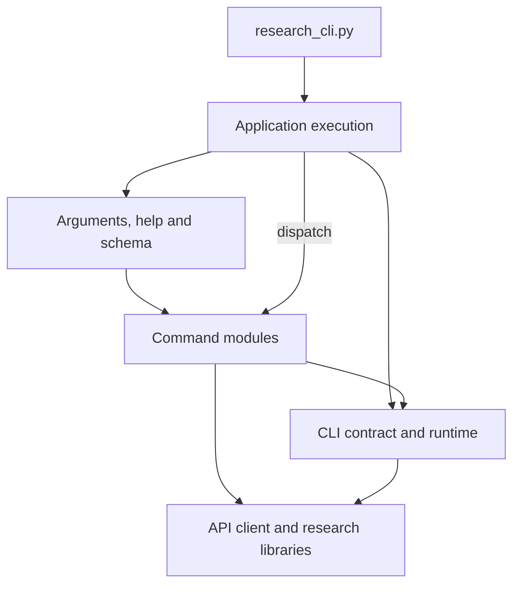

# Alpha Machine

Tools for researching [WorldQuant BRAIN](https://platform.worldquantbrain.com/)
alphas. Simulate FASTEXPR expressions and Python Alpha source, keep the evidence
from each experiment, and validate candidates against a frozen training choice.

The repository is built around one idea: **a program should be able to drive the
research loop without reading the source.** The core workflow is exposed by
`research_cli.py`, whose contract is documented by the tool itself. Batch
runners and the separate SPC client sit under `tools/`.

## Start here

v4 runs experiments through a **resident single-writer daemon** (`daemon`) and a
**persistent 4-gate state machine**. Every model command is short and non-blocking:

| Step | Command |
| --- | --- |
| Ensure resident daemon & read bounded workspace state | `python research_cli.py daemon start`, `python research_cli.py brief`, `python research_cli.py inbox` |
| Validate a spec offline and enqueue into `AUTO_PREFLIGHT` | `python research_cli.py propose SPEC.json` |
| Block efficiently on condition variable until a `GATE_*` arrives | `python research_cli.py wait --max-wait 30` |
| Inspect train-only screening results (Test firewall enforced before freeze) | `python research_cli.py inspect RUN_ID` |
| Advance through the 4 interaction gates (`hydrate-pnl`, `approve-full`, `describe`, `hold`/`submit --yes`) | `python research_cli.py act RUN_ID <action> ...` |
| Review ledger results & plan independent shelved submissions | `python research_cli.py ledger analyze --group-by scope --limit 8` and `python research_cli.py shelf plan` |

Keep one resident daemon per `--research-dir`. Subagents can safely draft specs,
call `propose` for independent hypotheses, call `inspect` / `inbox` / `runs`, and
query `ledger analyze` while the daemon serializes state writes under
`daemon/state.lock`. Before `act RUN_ID approve-full` freezes
`runs/<run_id>-selection.json`, `inspect RUN_ID` hides test-period metrics and
live checks at the protocol level.

[State-machine workflow and ledger review](docs/ledger-workflow.md) is the operating
guide with the full state diagram. [Fast backtesting](docs/fast-backtest.md) covers
throughput, wait budgets and concurrency measurements. [Tooling](docs/tooling.md)
is the per-command reference; `help COMMAND` and `schema COMMAND` expose live
options and the JSON contract.

## Layout

| File | Job |
| --- | --- |
| `research_cli.py` | Thin executable entry point. stdout is always one JSON document. |
| `pnl_store.py` | Immutable daily PnL Parquet generations (`base-*.parquet` and `deltas/*.parquet`) with a SQLite manifest and completeness evidence. |
| `workspace_db.py` | SQLite WAL store for state-machine runs, events, scheduling config, slot journals, and BRAIN Labs tickets. |
| `research_app/app.py` | Command execution, workspace selection, error envelopes and exit codes. |
| `research_app/parser.py` | Argument declarations, terminal help and the schema derived from the live parser. |
| `research_app/runtime.py` | Shared CLI contract, JSON output, protected state paths and authenticated sessions. |
| `research_app/state_machine.py` | Persistent 4-gate + `GATE_LABS` state machine, Train/Test protocol firewall and `migrate-workspace`. |
| `research_app/labs.py` | BRAIN Labs human-collaborator diagnostic ticket system and blind-simulation guardrails. |
| `research_app/sm_workers.py` | Autonomous worker transitions (`AUTO_*`), cost audit and orphan slot harvesting. |
| `research_app/daemon.py` | Resident single-writer HTTP loopback server, bearer-auth IPC and non-blocking CLI handlers. |
| `research_app/brief.py` | Bounded workspace brief, book health, out-of-sample views log and `breed` offspring generator. |
| `research_app/account.py` | Account access and local cache commands. |
| `research_app/catalog.py` | Dataset, datafield and operator discovery. |
| `research_app/validation.py` | FASTEXPR lint, Python Alpha static checks and simulation preflight. |
| `research_app/experiments.py`, `research_app/exp_*.py` | Labelled spec normalization, comparisons and ablation helpers. |
| `research_app/alphas.py` | Platform alpha inspection, native recordsets, correlations and submission reconciliation. |
| `research_app/simulation_import.py` | Read existing BRAIN simulations and recover their Alpha IDs. |
| `research_app/triage.py`, `research_app/promote.py` | Internal train-only screening and FULL validation helpers backing state transitions. |
| `research_app/selection.py` | Immutable training selection manifests and drift verification. |
| `research_app/buffer_cmd.py` | Append-only candidate shelf (`submit-buffer.jsonl`), seed store (`seeds.jsonl`) and `shelf` queries. |
| `research_app/pp_budget.py` | Structural Power Pool operator/field/dataset budget and gate summary. |
| `research_app/submission_planner.py` | Maximum-weight independent subset and submission ordering from train PnL correlations. |
| `research_app/description.py` | Evidence-bound Power Pool description assembly and near-duplicate checks. |
| `research_app/rules_snapshot.py` | Scoped, provenance-tagged snapshots of platform thresholds, quotas and themes. |
| `research_app/ledger.py` | Local ledger recording, labels, lineage, coverage, shared legs and offline queries. |
| `research_app/ledger_analysis.py` | Indexed funnel, failure-driver and cohort summaries over the local ledger. |
| `research_app/feed.py` | Multi-source research leads (papers, news, forum, market snapshots) with seen tracking. |
| `research_app/literature.py` | OpenAlex paper discovery and reading. |
| `research_config.py` | Research-file format: parsing and validation, shared by CLI and research scripts. |
| `machine_lib.py`, `brain_core/` | Public facade, canonical defaults and cohesive core submodules (`errors`, `auth`, `catalog`, `transport`, `simulations`, `alphas`, `client`). |
| `batch_policy.py`, `spc_experiment.py` | Pure QUICK structural/dataset admission policy and offline SPC prediction comparison. |
| `check_evidence.py` | Shared normalization and status classification for platform check payloads. |
| `simulation_capabilities.py` | Account identity and current settings evidence; unknown capabilities remain explicit. |
| `simulation_slots.py` | Durable simulation reservations shared by the same account and research workspace. |
| `simulation_multi.py` | Native Multi Simulation grouping, parent/child state tracking and reconciliation. |
| `registry_index.py` | Incremental SQLite index over `alpha-registry.jsonl` for fast novelty and cohort queries. |
| `expression_lint.py` | Pre-flight checks: real operator names, arity, learned rejections. |
| `expression_types.py` | Five field types, operator signatures, and the mismatches they imply. |
| `field_index.py` | Live field-name verification and vocabulary-free variant grouping. |
| `field_search.py` | Ranked local search over fields and operators: AND, exclusion, fuzzy. |
| `paper_search.py` | OpenAlex paper search: journal, DOI, citations, reconstructed abstract. |
| `field_contract.py` | Field contracts: declared vs inferred period/unit/sign, verdicts. |
| `research_paths.py` | Resolves where results go -- always outside this working tree. |
| `alpha_registry.py` | Append-only ledger of measured evidence and terminal failed attempts. |
| `correlation.py` | Align daily PnL on shared dates, Pearson, residualise against a control. |
| `ablation.py` | Leave-one-out and solo variants, so a leg can be shown to earn its place. |
| `cache_store.py` | Small JSON cache with TTL, so repeat calls do not re-fetch. |
| `fastexpr_ast.py` | FASTEXPR parser: tree, field extraction, skeletons, transforms. |
| `operator_semantics.py` | Invariants the operator catalogue does not publish. |
| `annotations.py` | `@annotation` vocabulary, staleness checks, ablation derivation. |
| `intent.py` | Rewrite "rank a level" into "rank a level over size". |
| `alpha_unit.py` | Compress the ledger into constructions: template, grid, derivation. |
| `expression_units.py` | Field units, harvested from the simulator's rejections. |
| `rejection_reasons.py` | Why a rejection happened: the cause, not just the gate. |
| `research_app/guarded_sim.py` | Bind simulation launches to preflight for the exact source and settings. |
| `research_app/batch_admission.py` | Account-and-scope QUICK exploration admission checks. |
| `tools/probe_units.py` | Measure a field's unit from the simulator's own rejection. |
| `research_app/substitution.py` | Whole-token field substitution: exact, identifier-bounded input replacement. |
| `tools/spc_client.py` | SPC prompt validation, forms and offline output comparison. |
| `tools/cluster_ledger.py` | Group the ledger by PnL correlation or by shared datafields. |
| `tools/dedupe_ledger.py` | Find identical-PnL entries that are one alpha filed twice. |
| `tools/degenerate_batch.py` | Flag a batch whose different expressions produced the same result. |
| `tools/derive_family.py` | Derive family labels from the datafield namespace. |
| `tools/unit_report.py` | How few constructions the ledger is, and what each has not tried. |
| `tools/parts_catalogue.py` | Reusable parts, screened by how many book families they serve. |
| `tools/backup_replay.py` | Snapshot the research directory; replay it as of a date; diff drift. |
| `tests/` | Offline contract, state-machine, and daemon IPC tests. No account required. |

`docs/tooling.md` maps these tools to the questions they answer.

**This repository versions the tool, not the research.** Simulation results,
field-catalog snapshots, the alpha registry and the learned operator denylist
all live in a results directory outside the working tree, resolved by
`research_paths.py`:

1. `$BRAIN_RESEARCH_DIR` if set;
2. otherwise `<persistent workspace>/worldquant-research` (`/data/worldquant-research`
   on this deployment -- `$HOME` is often an ephemeral container layer, and a
   registry that evaporates is no better than one never written);
3. otherwise `$XDG_DATA_HOME/worldquant-research`, then `~/.local/share/worldquant-research`.

`research_cli.py schema` reports the resolved path under `research_paths`. A
`research/` directory inside the repo is git-ignored as a guard rail, so a stray
run cannot quietly add data to the history.

Examples use placeholder alpha IDs and synthetic or qualitative case data. BRAIN's
metric definitions, platform thresholds, field/operator names and general concepts
remain literal; private account observations belong in the research directory.

## Application boundaries



Command modules return data or raise a typed error. The execution boundary owns
stdout, saving, workspace overrides and exit codes. The parser generates help
and schema from the argument declarations and loads handlers on demand.

Each CLI invocation restores the caller's diagnostic handler, metadata cache policy
and workspace settings when it exits, including on command failures.

The root libraries (`machine_lib`, `research_config`, `alpha_registry`, the expression
and field modules) implement reusable research behavior and never import the CLI
application. Add a command in its owning module, declare its arguments in
`research_app/parser.py`, and test the implementation module or the executable
contract. The entry point exports no command handlers or compatibility aliases.

`research_app` owns internal command and orchestration modules (`state_machine`,
`sm_workers`, `daemon`, `brief`, `guarded_sim`, `batch_admission`) with a strict
one-way dependency DAG (`core` / `brain_core` ← `research_app` ← `tools`). No
legacy v3 runner compatibility shims remain.

## The expression tree

`docs/ast-pipeline.md` explains why FASTEXPR is parsed into a tree, which operations
need structural parsing, and which can keep their existing implementation. Read
it before changing anything that extracts information from an expression by
pattern-matching the string.

## Documentation

| Page | Read it when |
| --- | --- |
| [Tool map](docs/tooling.md) | Choose a CLI command, inspect state-machine runs, or run companion scripts. |
| [State-machine workflow and ledger review](docs/ledger-workflow.md) | Operate `daemon` / `propose` / `inbox` / `act`, analyze the ledger, and manage the candidate shelf. |
| [Errors, status diagnosis and recovery](docs/errors.md) | Interpret `ERROR_CODES`, `GATE_PREFLIGHT_BLOCKED`, `stalled`, and `UNCERTAIN` recovery paths. |
| [Fast backtesting (中文)](docs/fast-backtest.md) | Diagnose slow or stalled work and measure accepted jobs, finished results and complete evidence separately. |
| [Expression pipeline](docs/ast-pipeline.md) | Understand FASTEXPR parsing, source identity, and structural analysis. |
| [Unit compression](docs/unit-compression.md) | Inspect FASTEXPR construction coverage and reproduce the report. |
| [Candidate gates and submission planning](docs/tool-absorption.md) | Understand Power Pool structural budgets, independent-subset planning, description checks and rule snapshots. |
| [Backup and replay](docs/backup-replay.md) | Archive research state, restore a workspace, or check historical results. |

For AI coding agents working in this repository, the workspace skill at
[`.agents/skills/worldquant-research-cli/SKILL.md`](.agents/skills/worldquant-research-cli/SKILL.md)
indexes these documents and encodes the pre-flight and error-recovery rules.

## Install

```bash
pip install -r requirements.txt
```

`requests`, `numpy`, and `polars` are loaded on demand. Help, schema, offline lint
and Probe previews can run without importing them; `fields_to_df()` returns a
`polars.DataFrame`, and PnL-intensive commands automatically maintain a unified
incremental Parquet cache under `<pnl_dir>/.parquet_cache/pnl.parquet`.

For repeated cross-batch training half-Sharpe reports, `ledger stability --polars`
also emits a pre-aggregated training snapshot receipt under `cache/`:

```bash
python research_cli.py ledger stability --polars
```

## Credentials

Copy the template and fill it in:

```bash
cp .env.example .env
```

`.env.example` lists the credentials and settings the tool reads, including BRAIN,
OpenAlex and Alpaca access and the research directory. A contract test verifies
that every environment variable referenced in the codebase stays documented there.

`.env` must sit next to `machine_lib.py`; the loader resolves it relative to the module,
so a `.env` elsewhere is silently ignored. It is git-ignored. Real environment variables (`BRAIN_USERNAME`,
`BRAIN_PASSWORD`) take precedence over the file:

```bash
export BRAIN_USERNAME=you@example.com
export BRAIN_PASSWORD=...
```

`machine_lib.get_credentials()` raises `MissingCredentials` when either is
absent — nothing silently sends an empty login.

The CLI reuses an unexpired session only if its account matches the configured
username. The CLI writes `<research_dir>/cache/session.json` atomically in mode
`0600` and coordinates concurrent logins with a file lock. Use `--relogin` for a
fresh login or `auth logout` to clear the session.

`catalog datasets`, `fields`, `find` and `categories` check account-scoped
metadata under `<research_dir>/cache/metadata/` before login. They open a session
on a cache miss and reuse it within the call. `--relogin` and `--no-cache` refresh
the session for these commands. `--refresh-meta` refreshes catalog data. The
default catalog TTL is 24 hours, configurable with `BRAIN_METADATA_TTL`.
`--meta-max-age` can tighten the accepted age and zero bypasses the cache.
A failed refetch can return a matching stale snapshot with `stale`, `degraded`
and an error code in the cache report.

```bash
python research_cli.py cache info                  # what is cached, how stale
python research_cli.py cache clear --kind metadata # drop catalog snapshots
```

## Driving it from a script or an agent

stdout is **always exactly one JSON document**, so every call is:

```python
result = json.loads(subprocess.run([...], capture_output=True).stdout)
if not result["ok"]:
    handle(result["error"]["code"], result["error"]["message"], result["error"]["hint"])
```

Progress goes to stderr, never stdout. Failures carry a stable `error.code` and
a process exit code (`USAGE`/`INVALID_INPUT` 2, `AUTH_*` 3, `RATE_LIMITED`/
`SERVICE_ERROR` 4, `NOT_FOUND` 5, `SIMULATION_FAILED` 6).

A failure can also carry `error.details`: the structured findings behind it, for
example every lint error per expression, so a caller can act without scraping the
message text.

### Discover the surface

```bash
python research_cli.py                         # concise guide
python research_cli.py help catalog fields     # examples and options for one task
python research_cli.py catalog                 # commands available in this group
python research_cli.py catalog fields --help   # terminal help, including defaults
python research_cli.py schema                  # full contract for tooling integrations
python research_cli.py schema alpha get        # just one command's contract
```

Common options work before or after any command: `--save PATH` creates missing parent
directories and atomically writes **the same complete JSON envelope as stdout**, including
failures; `--save -` uses stdout only. The destination is checked before execution.
`--compact` emits one line, `--quiet` suppresses progress while keeping errors, and
`--research-dir PATH` overrides the research directory for this invocation.

```bash
python research_cli.py --research-dir ./research ledger list --family quality
python research_cli.py simulate sample-batch.json --dry-run --compact --save preview.json
```

In CLI 3.0, local records live under `ledger`: `ledger list` combines the former
`alpha registry` and `alpha find` filters. `record`, `label`, `impact`, `lineage` and
`coverage` also moved from `alpha` to `ledger`. `alpha` reads or updates the platform;
`ledger` works locally except for `ledger record`, which fetches the selected alpha.

### Start a session with one bounded document

```bash
python research_cli.py brief             # book, recent scores/setbacks, questions and source paths
python research_cli.py brief --days 30 --top 10
```

It answers "where does the research stand" from the ledger, the result directory and
`open-threads.md`. `research_dir`, `ledger.path` and `threads.path` identify the sources;
the `exists` flags distinguish missing files from empty ones. An empty local workspace
does not establish that a direction has never been tried.

`recent.best` contains score leads with family/mechanism labels, measured inside the
train window; records without train metrics stay out of `best` and appear in
`missing_train_metrics`. `recent.setbacks` adds recorded `rejected`, `falsified` and
`no_go` decisions, including later relabels.
Its `count` covers all such records in the window; `items` takes the newest representative
per family/mechanism/verdict, using the record key when a mechanism is missing. These
are examples to investigate, not an estimate of failure rates or independent bets.

`--top` must be at least 1 and bounds each score, setback, write-up and thread list.
Threads retain file order and report their full `counts`; put current questions first.
Long question, idea, mechanism and note previews are capped at 240 characters, with `…`
marking truncation. Use the source path and ledger key to recover complete evidence
before interpreting a clipped conclusion.

Maintain one `- [open] **question** — evidence; next discriminating check` or
`- [closed] **question** — conclusion; evidence; reopening condition` per line in
`open-threads.md`. Keep detailed evidence in the linked ledger records and reports.
For the explore → select → experiment → review workflow, see
[the information flow guide](docs/tooling.md#给-ai-的信息按阶段进入).

### Read BRAIN documentation and forum posts

```bash
python research_cli.py docs list --query python
python research_cli.py docs get how-translate-fast-expression-alpha-python-alpha
python research_cli.py forum search "Systematic Predictions Challenge" --limit 5
python research_cli.py forum get 41113878259479
python research_cli.py forum get 41113878259479 --offline
```

These commands read with the current BRAIN account. The tutorial and support
sign-in routes were observed in BRAIN's web app. We have no verified public
developer contract for those routes. Forum and Help Center reads use the
documented Zendesk APIs once signed in.

Documentation retains the original content blocks. Forum and Help Center reads
retain the HTML body and source URL. Responses are cached per account. A fresh
hit skips authentication and remote requests. Use `--offline` for a cache-only
read or `--refresh-meta` to refresh the response. See pagination and cache
options in [the tool map](docs/tooling.md#读平台文档和论坛).

### Collect research leads across sources

```bash
python research_cli.py feed --from-threads --workers 4 --timeout 30 --dry-run
python research_cli.py feed --topic "analyst revisions" --topic "earnings quality" --action
python research_cli.py feed --seed W2741809807 --follow citations --dry-run
python research_cli.py feed --source all --topic "earnings guidance" --max-topics 12 --summary --dry-run
python research_cli.py feed --sources-file radar-sources.json --summary --dry-run
python research_cli.py feed --market coinbase:BTC-USD --book-depth 10 --summary --dry-run
```

Without source selection, existing paper queries remain the default. `--source all` selects
paper, news, social, forum and trends, plus configured sources. Markets require explicit symbols.
Custom RSS/Atom feeds and local JSONL/text exports use `--sources-file`.
See [source configuration and access limits](docs/tooling.md#多来源线索与本地论坛材料)
for adapters, credentials and the distinction between quotes and order-book depth.
The [external harvest format](docs/tooling.md#导入外部定向检索) imports search receipts and
source excerpts with structured research notes for the digest and draft cards.

`--workers` bounds concurrent retrieval jobs (1–8, default 4); `--timeout` bounds each
network request. Queries, reference/citation expansions, fixed feeds and markets share the
`--max-topics` job budget. Output retains input order and balanced picks regardless of
completion order. Paper keywords preserve provider relevance; graph results report their
own ordering and coverage in `retrievals`. A citation edge does not imply agreement.
The default citation floor is 0, so recent papers remain eligible; `--min-citations` is an
explicit optional filter. `provider_ranks` retains original query positions. `rank` remains
a legacy citation/year score, not the selection order.
`next_actions` supplies bounded, evidence-linked retries, deferred searches, source reviews
and contrasts. Its `argv` lists are arguments for `research_cli.py`, not shell strings.
Threads may state an authored query with `; query: ...`, including after a Chinese heading.

Paper caches use the effective request under `<research>/cache/papers/`. Identical concurrent
misses share one fetch. Writes are atomic, expired or corrupt entries refetch, and successful
retrievals survive cache write failures. Paper records preserve available landing-page/PDF links.

Results now share `items` rather than a paper-only `papers` array. Each item keeps its kind,
provider, provenance, publication and collection times, coverage and claim state.
`--summary` returns bounded excerpts and a table; `searches` distinguishes source failures,
empty results and already-seen items. An unavailable source does not prove absence of evidence.
Relative or ambiguous publication dates stay unknown, with their original text retained.

Common excerpts are bounded to 600 characters in full output. Paper-specific `abstract_chars`
and `abstract_truncated` distinguish an excerpt from a complete abstract. Paper review actions
include executable `paper --id` arguments, conditional full-text reading steps and reference
expansion. Other sources point to original links and archived evidence before forming a
testable question. Paper caches retain complete individual records, so reading a selected
paper normally needs no second request. DOI aliases are normalized against both new results
and the existing seen store. Feed itself never downloads paper full text.
`reference_count` keeps bibliography size visible without copying every reference ID into
the digest; the complete list remains in `paper --id` records.

Concurrent feeds reread seen state under a lock after retrieval. Selected source evidence
is archived under `<research>/inspiration/evidence/` before drafts and seen commit. Each file
is atomic; these writes are not a cross-file transaction. A crash can leave an unused archive
or repeated draft, and a crash after seen commits can consume picks before delivery. Dry-run
leaves evidence, seen and drafts alone; retrieval caches and an explicit `--save` may write.
Source text is untrusted evidence. Popularity, quoted results and current market snapshots
do not establish a mechanism, historical availability or backtest suitability.

`feed` evaluates data requirements only against a fresh, complete catalog snapshot
for the selected account, region, universe, delay and instrument type. Keyword-derived
needs remain inferred reading leads. Explicit field requirements can be available,
missing from a verified scope, or unknown; none of those states establishes a signal's validity.


### Python SDK (`BrainClient`)

For notebooks and Python scripts, `machine_lib.BrainClient` manages the private
account-bound session lazily and refreshes once automatically if an expired
cookie is rejected:

```python
import machine_lib as ml

with ml.BrainClient() as brain:
    # Offline payload preview (needs no credentials or network)
    preview = brain.simulate_one("rank(close)", mode="QUICK", dry_run=True)

    # Account, competitions & catalog point lookups
    me = brain.profile()
    challenges = brain.competitions()
    field = brain.field("fnd6_newa1v1300_assets")

    # Live simulation, checks & correlation endpoints
    run = brain.simulate_one("rank(close)", mode="QUICK")
    checks = brain.check(run["alpha_id"])
    self_corr = brain.self_corr(run["alpha_id"])
    pp_corr = brain.pp_corr(run["alpha_id"])
```

### Check the account, profile and competitions

```bash
python research_cli.py auth check
python research_cli.py auth profile --consultant
python research_cli.py auth competitions
python research_cli.py auth logout --remote
```

Returns `user_id`, `permissions` and `data_regions` verified by live catalog probes.
The current account's `OPTIONS /simulations` supplies allowed equity regions,
universes and delays; the check samples one advertised combination per region.
`data_scope_evidence` distinguishes available, empty and unknown probes and reports
the limited coverage. An error, stale fallback or unprobed combination never proves
that a region has no data. Authentication failures remain errors.

`data_scope_evidence.capabilities` retains the native settings schema, account fingerprint,
source, freshness and capability ID. Each online simulation/probe invocation refreshes it
once and reuses it across groups. Expanded or reduced choices therefore do not depend on
a historical local whitelist. The full `schema` exposes `settings_hints` for familiar values;
those hints are not permission limits. Missing, stale or unpublished evidence stays unknown.

New settings can be supplied in a research file or through repeated `--setting NAME=VALUE`.
Values accept JSON (including booleans, objects and explicit extension `null`) or unquoted
text, for example `--setting visualization=true`. Explicit generic settings override file
settings; conflicting generic/named flags are rejected. Dry-run checks structure without
claiming account availability. Published unsupported values block new submissions even
with `--allow-lint-errors`.

### Browse metadata (quota-free)

```bash
python research_cli.py catalog operators --search ts_ --group "Time Series"
python research_cli.py catalog categories                 # field/alpha counts = crowding
python research_cli.py catalog datasets --region USA
python research_cli.py catalog dataset fundamental6       # point lookup by dataset id
python research_cli.py catalog field fnd6_newa1v1300_assets # point lookup + FASTEXPR wrapper
python research_cli.py catalog fields fundamental6 --type MATRIX \
    --search liability --limit 20 --expressions
python research_cli.py catalog find "short term debt"
```

`--expressions` also emits ready-to-paste snippets, already winsorized and
backfilled. Add `--save out.json` to keep a snapshot for offline use.

Dataset and field commands accept `--summary`: at most 20 catalog rows, with
reported Pyramid multipliers, platform categories, and theme memberships. Nested
memberships are bounded to five entries with omission counts. Missing multipliers
stay unknown; they are never replaced with 0 or 1. `--expressions` follows the
displayed field rows. Omit `--summary` for the native catalog records.
`catalog datasets --theme true|false` sets the platform filter; omitting it leaves
the filter unset. These three queries use separate metadata-cache entries.

`catalog find` preserves native cross-sectional `coverage` and temporal
`dateCoverage` separately. The latter appears as `date_coverage`, with
`null` for an unavailable value. Ranking and `--min-coverage` use `coverage`.

`--search` is ranked, not a substring filter, and it runs locally over the
fetched catalogue so it can do what the endpoint cannot:

```bash
python research_cli.py catalog fields --dataset analyst4 --search "cfps number"
python research_cli.py catalog fields --dataset analyst4 --search "cfps -median"
python research_cli.py catalog operators --search "rank ts" --any-term
python research_cli.py catalog fields --dataset fundamental2 --search cfpps --fuzzy
```

Multi-word queries are AND, `-word` excludes, `--any-term` relaxes to OR, and
`--fuzzy` tolerates one edit. Hits carry `score` and `matched_terms`, so the
ordering is explainable. When nothing matches, the reply names the `absent_terms`
rather than quietly relaxing the query — assuming two words are synonyms is the
one thing this search refuses to do.


### Check field names and compare variants (quota-free)

```bash
python research_cli.py catalog verify --fields cfps_mean,anl4_afv4_cfps_mean --strict
python research_cli.py catalog concepts --dataset analyst4 --search cfps --min-spread 0.1
```

`catalog verify` answers one question: does this identifier exist in the live
catalog for this scope? A name typed from memory is not an operator, so the
operator catalog cannot see it, and the first symptom is a simulator error after
the submission has been spent. `simulate` now runs this check itself before
submitting anything and refuses to start on an unknown name.

`catalog concepts` groups fields that differ only in family boilerplate and shows
their coverage side by side. Two ids for the same quantity can differ by a third
of the universe, and nothing in the ids says so, so the choice is made on the
number. The grouping carries **no built-in vocabulary**: `--tail-tokens N`
compares only the trailing words, `--ignore-words` drops words you name, and
`--drop-numeric` ignores vintage numbers. Nothing about BRAIN's naming is
hard-coded, so the tool cannot rot into mis-grouping after a family is renamed.


### Simulate

Always validate before spending quota. `simulate` accepts an inline expression
directly as its positional argument, and `--quick` / `--full` set `simulationMode`:

```bash
python research_cli.py simulate "rank(liabilities/assets)-0.5" --quick --decay 4 --dry-run
python research_cli.py alpha cancel-sim SIMULATION_ID     # cancel a runaway task and release its slot
```

`--dry-run` prints the exact `POST /simulations` payloads without contacting
BRAIN, so it needs no credentials.

Then run for real:

```bash
python research_cli.py simulate sample-batch.json --sort sharpe --top 5 --stream
```

`--stream` emits JSON Lines progress events on stderr (`submitted`, `completed`,
`quota`, `rate_limited`) while the single JSON result stays on stdout. The result
contains one record per expression (`expression`, `decay`, `alpha_id`,
`status`, `metrics`, `checks`, `error`) plus a `summary` with counts, a
`ranking` sorted by sharpe, and `best`.

Simulation commands have a five-minute wait budget by default, configurable with
`--max-wait-seconds`. If `Retry-After` exceeds the remaining budget, accepted jobs
stay `PENDING`. The tool writes a mode-0600 checkpoint under `.brain_checkpoints/`
or to `--checkpoint`. Continue with `python research_cli.py resume CHECKPOINT`
to poll accepted jobs before sending queued work. An uncertain attempt without a
confirmed job identity stays `UNKNOWN_SUBMISSION` and requires reconciliation.

`--batch-size N` sets the requested concurrency on `simulate`, `probe` and `resume`, with no
fixed upper bound of three. A verified account limit clamps the request. When capacity is
unpublished, the default is `machine_lib.DEFAULT_LOCAL_CONCURRENCY` (currently 3), explicitly
labelled as local policy; a larger explicit budget is not proof of platform permission.
`scheduling` reports the request, effective budget, platform evidence and shared-slot state.

Invocations for the same identified account and research workspace share durable reservations
under `simulation-slots/`. Accepted and uncertain attempts keep their slots across interruption;
age alone never frees them. Observed completion or definite refusal releases a slot. Other
workspaces and jobs launched outside this tool are not coordinated. Resume may change
`--batch-size` without changing the saved expressions, settings or research fingerprint;
accepted jobs can still be recovered after launch permissions shrink.

Before each POST, the tool checkpoints the submission intent. If the shared slot
journal saved the accepted job URL just before an interruption, `resume`,
`probe --resume` and `probe --recover` restore it through the matching reservation.

Daily simulation quota is separate from concurrency and transient HTTP throttling.
Successful repeats and every successful multi-simulation child count; Alpha creation-date
filters cannot reconstruct that count.

Use `--multi-size N` on `simulate` or `probe` to opt in to native Multi Simulation.
Each parent holds 2–10 simulation objects that BRAIN runs in sequence. `--batch-size`
controls concurrent task slots, and the consultant documentation specifies up to eight
concurrent Multi parents. Native Multi requires `MULTI_SIMULATION` permission. Each
parent contains a compatible group, and a singleton tail uses the ordinary simulation path.

```bash
python research_cli.py simulate sample-batch.json --multi-size 4 --batch-size 2 --dry-run
python research_cli.py simulate sample-batch.json --multi-size 4 --batch-size 2 --checkpoint multi-run.json
python research_cli.py resume multi-run.json
```

The checkpoint retains the parent request and the child configuration for each result.
Resume reads accepted parents before dispatching any queued work. A failed parent can
still yield successful children, which are reconciled individually. `probe --from-simulation ID`
inspects an existing parent and its children.
[Consultant simulation features](https://platform.worldquantbrain.com/learn/documentation/consultant-information/multi-alpha-simulation)

`scheduling.quota` retains `X-Ratelimit-Limit`, `X-Ratelimit-Remaining` and
`X-Ratelimit-Reset` from simulation responses. `observed_at` and `reset_at` are Unix seconds;
`reset_seconds` is the original interval and `reset_after_seconds` is the remaining interval.
Unknown/malformed values stay null. Confirmed zero pauses new submissions, while accepted jobs
can still finish and queued work remains resumable. Observations share the account/workspace
journal; they are not reservations against the account's whole daily allowance.
After a known reset time the observation becomes `reset_due`; the tool does not invent a
refilled balance. If the reset header is missing, zero stops the current run, while a later
explicit invocation may obtain fresh evidence. Dry-run reports unknown quota without I/O.

A failed expression is reported in its own record instead of aborting the run;
the command only fails outright when *every* expression failed.

### Python Alpha

Save a whole Alpha as `signal.py`. The source below illustrates the input shape
for a short price-reversal experiment.

```python
from brain.alphas import alpha


@alpha(data=["returns"], store=[])
def signal(data, store):
    return (-data.returns[-1]).astype("float32")
```

A `.py` input to `lint` or `simulate` supplies one Python Alpha and sets the
language. A Probe spec declares the language and lookback in effective settings
and supplies either inline source in `expression` or a `source_file` path relative
to the spec. Save the example spec below as `python-reversal.spec.json` next to the
source. For a spec read from stdin, use inline `expression`.

```json
{
  "name": "python-reversal",
  "design": "explore",
  "settings": {"language": "PYTHON", "lookback": 0, "testPeriod": "P1Y"},
  "arms": [{"label": "recent-returns", "source_file": "signal.py"}]
}
```

```bash
python research_cli.py lint --file signal.py --setting lookback=0 --offline
python research_cli.py simulate signal.py --setting lookback=0 --dry-run
python research_cli.py probe python-reversal.spec.json --dry-run
python research_cli.py probe python-reversal.spec.json --check
```

Static lint parses a top-level `@alpha` function with two positional arguments
and reads the literal `data=[...]` declaration without executing the code.
Live preflight requires account-scoped evidence for Python and the declared
fields. The REGULAR request carries source in `regular` and omits `unitHandling`
and `nanHandling` for Python. It omits `selectionHandling` and `selectionLimit`
for both languages. The Alpha handles its own
missing values and output dtype. Preflight reports omitted settings under
`settings_capabilities.omitted_from_payload`. `--allow-lint-errors` cannot clear
Python preflight failures.

The runtime passes up to `lookback + 1` rows per field, with the latest row last.
Warm-up windows may be shorter. Static checks warn when a direct literal
`data.FIELD[-N]` or `data.FIELD[-N:]` exceeds the configured maximum. Return a
one-dimensional `float32` array with one value per instrument.

Python shares the existing ledger, PnL, checkpoint and recovery workflow.
The checkpoint contains the source itself, so resuming uses the captured version.
Python identity preserves whitespace and indentation and only
normalizes line endings. FASTEXPR AST transformations and structural comparisons
apply to FASTEXPR code.

A Probe with both languages uses `design: "explore"`. For a cross-language
comparison, explicitly align the daily PnL on shared training dates before
interpreting differences in scores.

### Probe a labelled experiment

Use one spec for a batch of arms and their settings:

Every controlled experiment has exactly one arm marked `design: "control"`.
Other arms use `add`, `drop`, `parallel` or `rescue`: add/drop/rescue keep the
control's effective settings; parallel changes exactly one setting; rescue also
names `proxy_of`. Validation uses resolved settings, including CLI overrides and
explicit arm decay. A scan declares `"design": "explore"` at the spec's top level:

```json
{"name": "sample-batch", "design": "explore", "settings": {"decay": 4},
 "arms": [{"label": "subindustry", "expression": "rank(close)"},
          {"label": "industry-fast", "expression": "rank(close)", "decay": 2,
           "settings": {"neutralization": "INDUSTRY"}}]}
```

An arm may declare `"role": "candidate"` or `"role": "diagnostic"`, independently of
`design`. Diagnostic arms remain visible for attribution but cannot enter candidate freezes,
the shelf, promotion or new submissions through that evidence. Refresh/recovery preserves
the role. Legacy records without a declaration remain `unspecified`; labels and notes do
not assign roles automatically.

```bash
python research_cli.py probe sample-batch.spec.json --dry-run
python research_cli.py probe sample-batch.spec.json --check
python research_cli.py probe sample-batch.spec.json --batch-size 6 --summary --batch-path sample-batch.json --save sample-response.json
```

`probe --dry-run` is a fully offline preview: it loads no session or credentials,
contacts no catalog, and spends no simulation quota. It validates every settings
group, resolves defaults and per-arm decay, and returns the complete settings and
exact `POST /simulations` payload for each labelled arm in `results`. FASTEXPR
lint includes the learned denylist. Python uses static source checks.
`blocking` lists local findings that would prevent a launch. Matching
private catalog snapshots can supply scoped field evidence, but live metadata remains
unchecked. `probe SPEC --check` authenticates and verifies the exact same resolved
requests without submitting a simulation. Missing, stale or incomplete required
catalogs block execution. A FASTEXPR `--allow-lint-errors` override preserves
those errors and leaves `preflight_complete` false.

A real probe validates every group locally before loading a session or submitting
anything, then checks current capabilities and required catalogs. The guarded launch reuses
that report only when its complete settings and expressions match exactly. Arms
with equivalent resolved settings and decay share a group. Results and ledger
entries retain each arm's actual settings and decay. The table and `rows` show
train-period metrics by default. Validation requires an existing frozen selection:
`probe --recover sample-batch.json --show-test --selection choice.json`.
`comparisons` reports arm-minus-control train deltas, with missing evidence listed
under `unavailable`; explore batches report no attribution. Spec `idea`, `mechanism`
and `note` travel with the preview, batch file and summary. Existing batch files
are protected before simulation. Continue an existing experiment through its
saved checkpoint; use a new spec and path for a different experiment. `--force`
is an explicit overwrite switch, not a recovery command or a way to resolve
an active writer, duplicate request or uncertain POST.

`--strict-gate` refuses a finished registry result with the same source identity
and complete effective settings. A dry run exposes `gate_blocking` and
`would_block`, along with available prior train metrics in `gate.completed_refs`.
`gate.structural_refs` gives related FASTEXPR history for review.

Preview also inspects the intended batch path. Pass `--batch-path` to check an
older batch. Exact matches may add `gate.checkpoint_completed_refs` or
`gate.checkpoint_recovery_refs`, with a read-only `probe --recover` command under
`next_actions` when an accepted job needs evidence. These references are for
explicit recovery or comparison. Simulation launches remain separate actions.

`probe` accepts the same settings and session flags as `simulate`. Explicit settings
override the spec and each arm's settings; an arm's top-level `decay` remains its
per-expression override. One real batch shares a session across all groups.
Use `probe - --dry-run` to read a spec from stdin.

The receipt includes the durable `path`, `run_id`, `started_at`, `request_fingerprint`,
original `arm_order`, per-arm submission states, `execution`, `recording` and
`next_actions`. `--batch-path` selects the canonical batch; `--save` only saves the
response envelope. Keep those files distinct and keep both under `research_dir`.
`--save` cannot overwrite the batch, checkpoint, recovery input or frozen selection.
Conflicts fail before execution; even the error envelope is kept off the protected file.

`probe --summary` adds a train-only table showing label, role, state, Sharpe, fitness,
turnover, margin in basis points, both train-half Sharpes and alpha ID. The response bounds
rows and preflight detail to 20, with total/omitted counts and the canonical evidence path;
the durable batch remains complete. Missing values render as `-`; measured zero stays zero.
For stored batches, use `compare sample-batch.json --summary --format markdown`. The table
is a field inside the same JSON envelope, so neither tailing stdout nor a parsing script
is needed to assemble it.

For Probe, `--max-wait-seconds` bounds simulation waiting across groups (default 300).
Use `probe --recover sample-batch.json` for platform reads and idempotent local recording;
it accepts the canonical batch or a saved response. Use `probe --resume sample-batch.json
--dry-run` to preview continuation offline, then omit `--dry-run` to explicitly continue
known queued/accepted work. Ambiguous submissions are not reposted. Interrupted
`simulate` jobs use `resume CHECKPOINT`. Same-batch writers and resumes are locked.

Execution failures and missing evidence remain deferred, separate from scientific
verdicts. Legacy batches with an unknown recording policy do not silently opt into
recording. Recovery preserves labels, settings, existing metrics and ACTIVE membership.
Train-half Sharpe stays unknown without both the train boundary and complete PnL evidence.

### Read a simulation launched elsewhere

```bash
python research_cli.py probe --from-simulation SIMULATION_ID --save external-simulation.json
```

Pass a simulation ID or its BRAIN API URL. The receipt lists child tasks in
platform order and exposes completed `alpha_ids`. Pending jobs report their
retry info. The command reads existing jobs and leaves the ledger unchanged.
To work with these IDs, explicitly record missing entries with `ledger record`
and pass the receipt to `triage --batch`. [Probe details](docs/tooling.md#批次流程与复用)


### Freeze a training choice, then validate it

The example files below belong in `research_dir`; use absolute paths or run from there.

```bash
python research_cli.py compare sample-batch.json --min-fitness 1 --cost-bps 5 10 20 --freeze choice.json --summary
python research_cli.py compare --frozen --selection choice.json --summary
python research_cli.py triage --batch sample-batch.json --freeze triage-choice.json
python research_cli.py triage --show-test --selection triage-choice.json
```

A freeze is an immutable manifest of ordered candidate identities, training evidence,
criteria and source inputs, with a stable content hash. Validation reuses the saved
set and order even when test rankings reverse. Extra candidates are ignored; missing
candidates remain explicit, without backfilling old/full-window metrics. Conflicting
filters, sorting, inputs or cost scenarios are refused. Validation logs its selection ID.
`--summary` bounds displayed comparison rows without changing the saved choice or counts.

Cost evidence retains the metric period and units. Raw margin is dollars of profit per
dollar traded; `margin_bps = margin * 10000`. `--cost-bps` gives one-way scenarios per
dollar traded (default 5, 10, 20), so `net_margin_bps = margin_bps - cost_bps`. Aggregate
turnover does not identify a daily trading path: daily costs and net Sharpe remain unknown.
Missing train margin is never replaced by full-window margin.

### Screen a campaign candidate before promotion

```bash
python research_cli.py triage --ids ALPHA_ID --against-shelf --max-shelf-correlation 0.7 --min-delta 0 --freeze campaign-choice.json
DESCRIPTION='Idea:
- Analyst estimate revisions contain information that enters prices gradually.

Rationale for data used:
- The specified analyst fields measure revisions and remain comparable in the frozen scope.

Rationale for operators used:
- rank compares firms cross-sectionally without treating raw scale as signal.
'
python research_cli.py alpha describe ALPHA_ID \
    --name "Analyst revision hypothesis" --category ANALYST --tags analyst revision \
    --description "$DESCRIPTION"
python research_cli.py promote ALPHA_ID --selection campaign-choice.json --max-self-correlation 0.7 \
    --name "Analyst revision hypothesis" --category ANALYST --tags analyst revision \
    --description "$DESCRIPTION"
```

If Campaign already emitted `training-frozen`, use its `selection_path` instead of
freezing the candidate again. Replace the example metadata with the selected
candidate's actual hypothesis and evidence.

With a shelf ceiling, `triage` writes the selection only after the local training
gate passes. It requires measured PnL coverage, positive book contribution,
and a candidate-to-shelf correlation below the ceiling. `training_gate`
explains a rejection or missing evidence. The shelf, book membership and source
identity are bound to the frozen choice.

`promote --selection` uses that exact single-candidate selection with its saved
retention floor and cost scenarios. It opens the test view, checks live
platform results, and writes to the shelf only if the gates pass. The optional
self-correlation ceiling is a separate live requirement. `--dry-run` still
accesses the test view and runs the platform checks.

Promotion records the submission candidate's metadata in the existing buffer/seed
store: a nonempty `name`, an allowed `category`, at least one entry in `tags`, and a
`description` containing at least 100 characters after trimming outer whitespace.
The description must use these exact headings, each followed by a `- ` list:
`Idea:`, `Rationale for data used:` and `Rationale for operators used:`. The old
all-caps `IDEA:` / `RATIONALE:` form is rejected. The order is: FULL complete →
`alpha describe` writes the description → `promote`/`buffer add` stores the seed
and checks for FAIL → `alpha submit` is called twice. `buffer add` rereads the
platform description and requires it to match `--description`, so the remote write
cannot be skipped. A FAIL such as `LOW_FITNESS 0.63` blocks shelving and submission.
`--seeds PATH` selects an alternate metadata store; use the same path for promotion
and any later `alpha submit` or `buffer submit`.

Research seeds have a different purpose: successful and terminal failed attempts
stay in the normal ledger with their original question and evidence. They do not
need submission metadata merely to be remembered. See the
[operating guide](docs/ledger-workflow.md) for the single workflow.

`campaign` uses the existing `backlog/` inbox and durable Probe checkpoints.
It previews or advances Regular, Power Pool, ATOM, and Python research, and
compares recorded SPC outputs locally. See [the campaign workflow](docs/tooling.md#长程研究队列).

```bash
python research_cli.py campaign preview SPEC.json
python research_cli.py campaign status
python research_cli.py campaign run --recover-only
python research_cli.py campaign run --watch --multi-size 4 --stream
```

The unified runner freezes eligible FULL Regular training choices. Use
`--validate` to continue with validation. If validation and checks pass but the
candidate's metadata is missing, promotion returns `outcome: metadata_required`,
`buffered: false`, the missing fields and a `next_action` using the frozen choice.
Supply its `required_options` through the promotion command above. The runner
retains this outcome rather than retrying the same missing metadata each round.
A dry run without the metadata also reports `metadata_required`, not `would_buffer`.
Missing scientific evidence stays queued with a recorded reason.

### Inspect results

```bash
python research_cli.py alpha get ALPHA_ID
python research_cli.py alpha list --min-sharpe 1.5 --limit 20
```

Both are quota-free.

`alpha get`, `alpha check`, and `probe --summary` expose bounded `incentives`
metadata for `MATCHES_PYRAMID` and `MATCHES_THEMES`. The ordinary checks retain
all provider fields. `alpha get` labels this evidence as an alpha snapshot;
`alpha check` labels it as coming from the live check endpoint. Native `effective`
and `multiplier` remain separate fields, and `WARNING`/`PENDING` remain explicit.
Theme matches do not replace quality checks or multiply performance statistics.

Read the platform's merged portfolio comparison explicitly:

```bash
python research_cli.py alpha get ALPHA_ID --performance
python research_cli.py alpha get ALPHA_ID --performance full --team TEAM_ID
python research_cli.py alpha get ALPHA_ID --performance --competition COMPETITION_ID --max-wait 0
```

The default scope is the current user; team and competition scopes are mutually
exclusive and require `--performance`. The summary preserves native before/after
statistics and score, computes after-minus-before deltas only for available
finite numeric statistics, and omits `pnl` and `yearlyStats`. `full` preserves the
whole response. Missing values stay unknown. The read honors `Retry-After`, with
a default waiting budget of 180 seconds; `--max-wait 0` makes one request without
waiting. Pending reads remain incomplete and report when to poll again.

`merged_performance` includes scope, source URL, retrieval time, and
`train_only_verified: false`: these statistics are not established as train-only
evidence. Successful reads are logged as validation views. This is a read-only
comparison and does not submit the alpha.

```bash
python research_cli.py alpha get ALPHA_ID --recordsets
python research_cli.py alpha get ALPHA_ID --recordsets yearly-stats coverage turnover
```

`--recordsets` discovers native names and reads only those explicitly requested.
Responses preserve the native schema and rows with source and completeness
evidence. Series reads are validation views with unverified train boundaries.
Use `--save` to keep the response in the research directory.
[Availability and wait behavior](docs/tooling.md#读取-alpha-的诊断记录集)

The daily-PnL reader used by the ledger and correlation tools honors `Retry-After`
even on a nonempty HTTP 200. It defaults to a 180-second budget and preserves the
previous cache when a pending read ends as `RATE_LIMITED`.

`alpha list` filters on `status=UNSUBMITTED` by default, so it will not show
what you have already submitted. Read the live book with:

```bash
python research_cli.py alpha list --status ACTIVE --limit 30
```

Or ask for the book directly — it joins each submitted alpha with the ledger's
mechanism label, and can report how a candidate would sit against it:

```bash
python research_cli.py alpha book
python research_cli.py alpha book --check ALPHA_ID
```

### Check the ledger before spending a simulation

The most expensive mistake in this workflow is re-testing a field that was
already falsified. `ledger list` answers that offline, with no network call:

```bash
python research_cli.py ledger list --field anl4_cfo_number
python research_cli.py ledger list --mechanism revision --verdict rejected
```

`already_tested: true` in the output means a prior entry mentions that field;
read its verdict and metrics before writing a new expression.

Verdicts are not all failure states:

| verdict | meaning |
|---|---|
| `candidate` | passed the gates; keep it |
| `watch` | interesting but below threshold, or correlation unverified |
| `rejected` | the expression underperformed; the hypothesis was never on trial |
| `falsified` | a pre-registered hypothesis was tested with controls and the controls won — a result, not a failure |
| `no_go` | abandoned before a fair test (data blocked, unusable fields) |

`falsified` is the one worth protecting: it is what stops a later round from
re-opening a mechanism that was already ruled out, so put the deciding control
in the note.

### Mechanism labels overstate diversity — read the family count

`mechanism` is specific on purpose: one label per construction. Multiple labels can
describe variants of the same underlying exposure, so label counts alone do not
establish diversity.

`family` is the declared second level (`oi`, `quality`, `leverage`, `option`,
`analyst`, `event`, `reversal`, `momentum`, `attention`, `other`) and it is
never inferred: a keyword guess would label an analyst forward-EPS alpha as
`analyst` when it is really a `quality` bet.

```bash
python research_cli.py alpha book           # book_size / mechanism_count / family_count
python research_cli.py ledger list --family quality
```

Use `family_count` to group declared research families and `mechanism` to distinguish
constructions. Neither count proves independence; inspect daily PnL as well.

### Read the checks that matter (including self-correlation)

`alpha get` returns the **cached** check snapshot embedded in the alpha body,
where `SELF_CORRELATION` is usually `PENDING` or missing. That is a caching
artefact, not a permission limit: `GET /alphas/{id}/check` triggers the
computation and replies with `Retry-After` until the job finishes.

```bash
python research_cli.py alpha check ALPHA_ID          # compute and print live checks
python research_cli.py alpha check ALPHA_A ALPHA_B --workers 2 --max-wait 300
python research_cli.py alpha readiness ALPHA_ID      # one-shot checks + Power Pool budget + description review
python research_cli.py alpha readiness ALPHA_ID --track POWER_POOL \
    --idea "High cash-flow-to-assets firms earn higher subsequent returns." --apply-description
python research_cli.py alpha prod-corr ALPHA_ID --save-archive pc.json
python research_cli.py alpha pp-corr ALPHA_ID
python research_cli.py alpha get ALPHA_ID --correlations
```

One or several IDs use the same response shape: `count`, `results`, `complete` and
`summary`. IDs are deduplicated in first-seen order; results retain that order even
with concurrent workers (`--workers` accepts 1–3, default 1). Each row separates
`status` (`complete`, `pending`, `error`) from `outcome` (`passed`, `failed`,
`warning`, `pending`, `error`). A resolved `FAIL` is complete evidence of failure;
missing or unresolved checks keep the row incomplete. A row can therefore have
`outcome: failed` while another check still leaves `status: pending`.

Top-level `complete` requires every row to be complete. `summary` counts status
values and the `passed` / `failed` / `warning` outcomes; it is not a pass count
disguised as completion. An individual request error stays in that row's `error`
and does not discard other results. `--max-wait` is the async-check wait budget
for each alpha (default 180 seconds), not a shared budget for the batch.

### Check self-correlation locally, and correctly

```bash
python research_cli.py alpha self-check ALPHA_ID
python research_cli.py alpha self-check ALPHA_ID --as-of 2026-01-01T00:00:00Z
```

Daily Pearson provides the local correlation estimate. Weekly and monthly
aggregation are diagnostics because changing the sampling window changes the
quantity being compared.

Local/platform calibration must use the same peer set and observation time.
Otherwise book growth can look like measurement bias. `classify()` applies its
configured bias and margin when producing a local verdict; calibration parameters
are model assumptions, not platform thresholds or a guarantee of submission.

The peer set and timing are part of the evidence:

* **Include in-flight submissions.** Recent candidates can share exposure even
  when they are absent from the platform's current ACTIVE snapshot. Local checks
  include recent candidates by default (`--include-unsent-hours`, default 24).
* **A published platform value is historical.** A later book can contain new
  counterparts. `--as-of` restricts peers to the submission cutoff so the comparison
  uses the intended historical set. Parse timestamps with their timezones instead
  of comparing timestamp strings.
* **A peer with no number is a gap, not a zero.** A flat PnL series has no Pearson
  correlation with anything, and a peer whose PnL has not been written yet has no series
  at all. Both are listed in `peers_unmeasured` with a reason (`undefined`, `no_pnl`,
  `short_overlap`). `clear` is a claim about every peer, so one gap downgrades the verdict
  to `unknown`; `blocked` and `borderline` stand, because missing evidence can only add a
  reason to refuse.

The report says so explicitly when the counterpart entered after the candidate
(`counterpart_entered_after_candidate`), instead of leaving a number that looks like a
disagreement with the platform.

### Submission is locked by default

Real submissions are refused unless `.env` (or the environment) contains exactly:

```
ALLOW_AGENT_SUBMIT=true
```

Unset, empty or `false` all leave the lock closed, and so does every other spelling — `1`,
`yes`, `TRUE`, `on`. Surrounding whitespace is forgiven, because a stray space says nothing
about intent; anything else is ambiguous, and ambiguity resolves to "no".

With the lock closed the CLI still backtests, runs the platform's checks and analyses
self-correlation. It refuses only the one irreversible action, before it touches the network:

```json
{"ok": false, "command": "alpha", "error": {
  "code": "SUBMIT_DISABLED",
  "message": "submission is disabled: ALLOW_AGENT_SUBMIT is not 'true' ...",
  "hint": "this is a policy lock, not a failure: set ALLOW_AGENT_SUBMIT=true ..."}}
```

Exit code `7`, distinct from a service error, so a caller can tell "policy says no" from
"something broke" and stop asking instead of retrying.

### Submit (and the "test submission")

There is **no separate test-submission endpoint**. The pre-submission test *is*
the check flow above; the only write action is `POST /alphas/{id}/submit`.
`alpha submit` therefore defaults to a dry-run that runs the live checks and
reports the correlation that would decide the submission, and only writes with
`--yes`:

```bash
python research_cli.py alpha submit ALPHA_ID          # dry-run, nothing written
python research_cli.py alpha submit ALPHA_ID --yes --selection choice.json
```

A new real submission requires membership in a saved compare/triage training choice.
It also requires a valid seed stored by `buffer add` and a matching official-template
description already written to the alpha with `alpha describe`. The required order is:
FULL complete → `alpha describe` → `buffer add --name --category --tags --description`
→ `alpha submit` twice.
Confirmed submissions always reconcile the ledger, shelf and PnL cache and invalidate
the old platform book snapshot. `--record` is no longer a submission option. The result
separates remote `submission` from local `reconciliation` and lists `repair_actions`.
Rerunning the command for an already confirmed alpha repairs local evidence without
another POST; unresolved durable intents permit only platform read-back.

`ledger sync --pnl` captures the selected status/hidden/type scope with a timestamp,
member digest and pagination completeness. It reports membership, metadata and PnL
coverage separately. Reverse drift requires a complete listing and individual status
reads. Local book members are ACTIVE/SUBMITTED; a local count alone never certifies a
complete current platform book. Legacy PnL has unknown completeness until refreshed;
new metadata binds complete coverage to the alpha ID and a hash of the cached series.

An alpha also carries metadata, and a submission is unattributable without it. `name`,
`category` and `tags` are top-level properties; `description` is writable too but **nested
under `regular`** — `{"regular": {"description": ...}}`. Eighteen *top-level* spellings all
returned `Unexpected property` and the conclusion drawn was that the field did not exist;
it was the shape that was wrong. A new `alpha submit` requires both the local seed
record produced by promotion and the required live platform metadata. Local seed
metadata does not automatically update the platform's properties; use
`alpha describe` before `buffer add` for the authorized remote description write.
Saved pending submission recovery and confirmed-submission reconciliation
remain available without creating a new seed record.

```bash
python research_cli.py alpha describe ALPHA_ID \
    --name "Sample research candidate" --category FUNDAMENTAL \
    --tags quality,cashflow --color GREEN \
    --description 'Idea:
- Higher quality firms should earn higher subsequent returns.

Rationale for data used:
- assets: total reported corporate assets.

Rationale for operators used:
- rank: compares firms cross-sectionally.'
```

Categories are an enum discovered by probing, because an invalid value returns 400 without
listing the choices: `ANALYST`, `FUNDAMENTAL`, `PRICE_VOLUME`, `SENTIMENT`, `VOLUME`.
Power Pool descriptions must use exactly `Idea:`, `Rationale for data used:` and
`Rationale for operators used:`, each on its own line and followed by at least one
`- ` bullet. The template source is `getting-started-power-pool-alphas`.

### What "submitted" actually means

Three outcomes look similar and are not:

| response | meaning |
| --- | --- |
| `403` with a check list | evaluated and refused; retain the reported checks |
| `201` with an empty body | accepted for asynchronous evaluation; **not** a submission |
| `dateSubmitted` set, or a live `ACTIVE` / `SUBMITTED` status | confirmed platform submission evidence |

A first `POST` may return before asynchronous evaluation finishes. A later check
can still refuse the candidate. Confirm the platform's read-back evidence rather
than inferring success from the initial HTTP status alone.

`alpha submit` reports an explicit `submission` state instead of treating HTTP success as confirmation:

| `submission` | meaning |
| --- | --- |
| `CONFIRMED` | read-back confirms submission by `dateSubmitted` or live `ACTIVE` / `SUBMITTED` status |
| `ACCEPTED` | the platform took the request but `dateSubmitted` is still empty - re-check before counting it |
| `REJECTED` | refused, with `failed_checks` naming what failed and its value |
| `UNCERTAIN` | accepted, but the read-back failed; the outcome is unknown |
| `INTENT` / `UNKNOWN` | a durable attempt lacks a confirmed outcome; read back, never implicitly POST again |
| `NOT_SENT` | a dry run or a preparation failure known to have ended before POST |

`submitted` is true only for `CONFIRMED`. An HTTP status below 400 alone does not
establish that the alpha entered the book.

To inspect a pending final-alpha submission without sending another POST:

```bash
python research_cli.py alpha submit ALPHA_ID --max-wait 30
```

For a saved unresolved attempt, this reads the alpha and its submission endpoint.
`submission_recovery` records the source, state, reason and any retry time. Ready,
resolved failure checks establish `REJECTED`; missing, pending, empty, 404 or failed
reads keep the outcome uncertain. `UNSUBMITTED` alone does not prove that a prior
POST never happened. Without `--yes`, the submission journal is unchanged.

When a saved unresolved attempt exists, repeating the command with `--yes` under
the existing submission authorization persists a confirmed recovery outcome and
returns without another POST in that invocation. A new-format interrupted intent
still in `PREPARING` can likewise be resolved to `NOT_SENT` before a later explicit
attempt. The durable `submit_posting`
boundary separates preparation failure from ambiguous transport after POST begins.
`post_attempted` describes the current invocation; a read-only recovery reporting
`false` does not erase uncertainty about the earlier attempt.

The platform's own view names the counterpart, which is what makes the substitute route
decidable:

```bash
python research_cli.py alpha self-corr ALPHA_ID
```

The report includes the candidate's Sharpe, maximum correlation, required Sharpe,
verdict and counterpart details. These are live evidence for the selected alpha;
private result snapshots belong in `research_dir`.

The margin applies to **every** counterpart above the limit, not to the most-correlated
one — taking the counterpart of the maximum understates the bar exactly when a second,
higher-Sharpe neighbour exists. Two related traps are handled rather than discovered:
`/correlations/self` answers `200` with an empty body plus `Retry-After` when it is not
ready (a blank body is retried, because reading it as "no data" reports a correlated alpha
as clear), and the recordset we use is `/recordsets/daily-pnl`, which is already daily, so
the documented requirement to difference a cumulative series does not apply here.

### Dimensions: do not add market cap to a balance-sheet item

`cap + abs(liabilities)` is refused by the simulator: market capitalisation carries
`Unit[CSPrice:1,CSShare:1]` — price times shares — while total liabilities is dimensionless
in this catalogue. Check the measured units before combining these quantities.

`lint` now says so first:

```
unit_mismatch: infix arithmetic mixes cap (Unit[CSPrice:1,CSShare:1]) with
abs(...) (dimensionless); the simulator refuses operands of different units.
Divide by a common scale instead of adding.
```

The units are **measured, never assumed**: `tools/probe_units.py` reads them out of the
simulator's own rejection message, and an error observed at simulation time is recorded in
the same cache. A field with no measurement yields no finding — the same rule the type
checker follows, because a guess that misfires trains the operator to ignore the check.

Scope is deliberately narrow: additive operators and comparisons must see two operands of
one unit, which is exactly the class that costs a round trip. Multiplication and division
combine units so a nested expression can still be judged; a fractional exponent drops the
unit rather than inventing a square root.

Two details were learned by getting them wrong. The first version only matched the function
form `add(a, b)` and stayed silent on `a + b`, which is the form that failed. And infix
splitting has to treat a leading `-` as unary, or `-rank(close) - 0.5` looks like a
mismatch.

### The turnover floor, checked mechanically

Disclosure fields can express useful mechanisms, but a construction driven only by
infrequent filings may not clear the platform's 0.01 turnover floor. A leg that
reprices daily can change that behavior; it still needs simulation and validation.

`lint` reports `turnover_floor_risk` when a disclosure-only construction lacks a
market-driven leg. This is a structural warning about update cadence, not a stored
performance result or a reason to discard an entire data family.

The check reads **which fields carry market data**, taking that from the catalogue's
dataset rather than from a list of names. Its subject is the expression, not the field: the
finding says "add the leg", never "avoid the data". The first attempt keyed on "has a time-series
operator" and was wrong in both directions: `ts_backfill` is a fill, not movement, so a
static ratio passed silently; and `close/vwap` has no window at all, so a shape that turns
over hundreds of times a year was flagged.

It is a warning, not an error: a low-turnover signal is legal, it simply cannot pass. The
dataset split lives in one visible constant (`DISCLOSURE_DATASETS`, named for the release
cadence rather than for any judgement about value) instead of being inferred inside the
linter, so the assumption can be read and argued with.

### Review fields before drafting a scan

```bash
python research_cli.py mine --dataset fundamental2 --limit 5
python research_cli.py mine --dataset news18 --expr 'vec_sum(reviewed_event_field)' --emit draft.json
```

`mine` reads local metadata in the default simulation scope and shows the selected
cache source, age and freshness. It excludes explicitly different scopes and
prefers scoped, fresh, newer snapshots deterministically. Unknown legacy scope
remains marked unknown; this offline review does not verify the current account.

`top` contains numeric MATRIX fields for review. `needs_definition` keeps labels,
forecast-type codes, dates, vague definitions, VECTOR/EVENT reductions and fields
sharing a description with an already-used field. Related ledger records are
shown as evidence, not proof that two fields are interchangeable aliases.
Numeric counts are not rejected merely because their values are integers.

Unused means absent from parseable latest ledger expressions. The AST excludes
comments, strings and local variables; parse failures are reported. Older reports
and unrecorded experiments still need checking before calling a mechanism new.
Dataset turnover uses only the selected registry's training metrics, with sample
and missing counts. It describes mixed constructions, not field update cadence
or a forecast of the next expression's turnover.

Automatic `--emit` drafts only numeric-review fields and never chooses `vec_avg`
for a vector. Use explicit `--expr` after choosing the economic aggregation.
Drafts do not overwrite existing specs and are saved atomically. Define units,
timing/PIT, direction and controls before `probe --dry-run` and online `--check`;
neither a high coverage nor a numeric type establishes signal validity.

### Types: five kinds of field, and the operators that accept them

The platform's field filter offers five types — `Matrix`, `Vector`, `Group`, `Universe`,
`Symbol` — and an operator accepts specific ones. `expression_types.py` carries the
signature table and checks arguments against it:

```python
rank(five_minute_price_change_pct)              # type_mismatch: rank expects MATRIX
rank(vec_avg(five_minute_price_change_pct))     # ok: the vector reducer returns MATRIX
multiply(five_minute_price_change_pct, 2)       # type_mismatch
group_rank(close, close)                        # type_mismatch: the group slot wants GROUP
group_rank(close, subindustry)                  # ok
group_rank(close, bucket(rank(close)))          # ok: bucket returns GROUP
densify(close)                                  # type_mismatch: densify wants GROUP
```

Type checks follow the expression AST through assignments, calls and infix operations.
Known operator signatures determine accepted types: reduce a confirmed VECTOR before
applying a MATRIX operator, and never use a UNIVERSE value as a numeric signal.
Unknown field types remain unknown and do not generate speculative reducer advice.
`bucket` returns GROUP. Economic units, target periods and nested derived expressions
have separate field-contract evidence; unverified economics produces warnings, not
automatic formula rewrites. Current authenticated operator metadata determines availability;
historical account restrictions are not hard-coded as universal operator errors.

### Lint before you spend a simulation

```bash
python research_cli.py lint 'rank(ts_delta(close, 5))'
python research_cli.py lint --file sample-batch.json --dataset fundamental6
python research_cli.py lint --offline 'rank(close)'      # no account needed
```

The operator names in a FASTEXPR expression are checked against `GET /operators`, the
authoritative list -- not the documentation site, which describes operators the
simulator does not accept. (`regression_neut` is the cautionary example: a docs
page exists, the operator does not.) `simulate` runs the same check before
submitting. FASTEXPR can explicitly override lint errors with
`--allow-lint-errors`. Exit code is `2` on a lint failure and the
error envelope carries every finding under `error.details`.

Online `lint` and simulation preflight derive names and types from one exact field scope.
Both reject a raw VECTOR passed to `rank`; use `rank(vec_avg(vector_field))` when the
catalog confirms VECTOR input. Complete captures save private account-bound snapshots.
Simulation preflight extracts used fields from the AST and verifies exact IDs in
the authenticated account and field scope. Successful positive proofs are saved
incrementally and can be reused by a later resume under the same metadata TTL and
maximum-age policy. Reuse preserves the original observation time; forced refresh
and disabled caching do not reuse persisted proofs. Unverified fields use the
remaining caller deadline rather than an additional eight-second request cap.
Receipts distinguish `required_fields_only` verification from full catalog completeness;
partial proofs never overwrite complete offline snapshots. A raw catalog cache hit
does not establish an exact preflight proof. Missing, ambiguous, stale, damaged or
mismatched evidence remains unknown.
Offline lint uses only a matching fresh, complete snapshot and performs no authentication
or network access; stale, partial, legacy or mismatched metadata stays unknown.
`tools.guarded_sim` uses the same core field enumerator.

Probe checkpoints retain per-group retry times for temporary field-service failures
and exhausted preflight budgets. Immediate resume calls skip cooled groups; successful
field proofs survive so later attempts can advance. Campaign respects these times
while continuing due accepted-job recovery. A rate-limit cooldown blocks new
preflight requests in that saved batch for the same account; ordinary service
failures defer only the affected group.

Rejections the simulator reports are written back to
`<research_dir>/operator-denylist.json` with a severity: `block` when the operator
is unknown or unavailable, `warn` when it merely rejects that kind of input (for
example `subtract` refusing event inputs). The file persists across sessions, so
the lesson survives even though it is not in git.

### Audit a field set before combining fields

```bash
python research_cli.py catalog field-audit \
    --fields fnd6_newa1v1300_capx,fnd6_newa2v1300_oancf,fnd6_newa1v1300_at \
    --operation ratio
```

The catalog tells you a field's coverage and delay; it does not tell you the
unit, the currency, the fiscal period, the sign convention or how corporate
actions are handled. Those unknowns -- not the economics -- are what sink ideas,
so they are made explicit per field as `declared`, `inferred` (with the rule that
produced it) or `unknown`, and the operation is then judged:

| verdict | meaning |
| --- | --- |
| `ready` | period and unit are known and consistent; no caveats |
| `needs_review` | usable, but fiscal alignment or sign convention is unverified |
| `blocked` | a critical attribute is unknown; do not compute on it yet |

Operations: `ts_difference` (one field over time), `ratio`, `difference`, `sum`.
Differencing a share count is blocked outright because no split basis is
declared; a sum or difference of fields with undeclared sign is blocked because
one negative stored value inverts the signal. Quota-free.

### Measure a unit instead of guessing it

The catalogue does not declare units, and `field-audit` can only say `unknown`. There is
one way to find out: add the field to a pure number and read the rejection.

```bash
python tools/probe_units.py --fields fnd6_newqv1300_invfgq,fnd6_newqv1300_invwipq
```

```
fnd6_newqv1300_invfgq   Unit[TSPrice:1]   simulator named the field unit as expected
fnd6_newqv1300_invwipq  dimensionless     add with a scalar succeeded
```

Answers are cached in `<research_dir>/field-units.json` so a probe costs one simulation
only once. Two details are easy to get wrong and both are pinned by tests:

* the simulator reports `expected "Unit[TSPrice:1]", found "Unit[]"` — the **expected**
  side is the field and the **found** side is the bare scalar, so reading `found` inverts
  every answer;
* a unit mismatch can arrive as `WARNING` as well as `ERROR`, so the error text is
  inspected before the status.

This distinction is worth acting on: `unknown` is a prompt to measure, `absent` is a
reason to stop. A measurable unknown needs evidence before a mechanism can be judged.

## Templates: use units, not macros

A template with slots is `alpha_unit`'s job: every expression in the ledger already
decomposes into a template plus a filling, and the unit also knows which grid points
were never run. `python3 tools/unit_report.py --derive <key>` lists them. The old
text/tree macro system that did the same thing by hand-written `def` blocks was
removed because unit templates also track derivations and coverage. Keep private
experiment plans and their outcomes in the research directory.

Probe and campaign specs use native FASTEXPR or Python. The shorthand generator
library was removed; expand any legacy shorthand to FASTEXPR before saving a spec,
because the spec is the reviewed artefact.

New FASTEXPR simulations apply the shared formatter to the wire source by default.
Dry runs expose the same source in `payload.regular`. Existing checkpoints retain
their original request identity. The `fmt` command previews a draft independently
and rewrites it only with `--write`.

### Report the pool as a distribution

A best-alpha report hides what a pool is: two pools can share a top result and differ
completely in spread, one narrow and correlated, one broad and independent.

Use `python research_cli.py health --pool` to inspect the current pool. Compare the
distribution of Sharpe, turnover, holding days and pairwise correlations, rather
than quoting only the best alpha. Shared PnL can reveal concentrated exposure
despite distinct names or expressions. Percent-of-capital volatility requires
capital data; an unavailable denominator must not be replaced by an invented one.

#### Forecast fields: frequency is not target period

`period` answers "how often is this estimate produced". It does not answer "which fiscal
year does this observation target", and the catalog never says. The contract therefore
carries two more attributes, kept deliberately separate:

```json
"target_fiscal_period":         {"state": "unknown", "evidence": "none"},
"historical_target_alignment":  {"state": "unverified", "lookback": null}
```

Field metadata cannot supply an expression's lookback. Window evidence belongs to the
actual operation being audited.

The consequence is a verdict change: `ts_difference` over an analyst forecast field now
returns `needs_review` with `target_fiscal_alignment_unverified`, where it used to return
`ready` as soon as the frequency was known. A 63-day difference of an annual estimate is
not necessarily the revision of one forecast — it can be a comparison across a fiscal-year
rollover, and reading it as a revision invents a signal.

The flag is narrow on purpose: the analyst dataset and the `anl4` prefix. Differencing a
reported accounting figure is unaffected, because blocking the whole field catalogue would
trade one mistake for a worse one.

### Remember what you found

```bash
python research_cli.py simulate sample-batch.json --record --idea "Sample hypothesis" \
    --mechanism "sample mechanism"
python research_cli.py ledger record ALPHA_ID --idea "Sample hypothesis" \
    --verdict candidate --note "why it mattered"
python research_cli.py ledger list --format markdown --min-sharpe 1.25
```

`<research_dir>/alpha-registry.jsonl` is an append-only ledger, one evidence event
per line, kept outside git so findings outlive a chat window without turning the
repository into a data dump. Back that file up like any other result; it is the
durable memory of the research. Entries retain the expression, full settings,
idea and source, with observed metrics and checks when available, a research
verdict and a note. Re-recording the same key folds its latest evidence on read
without rewriting history. `simulate --record` classifies automatically (clears the bar →
`candidate`, fails a check → `rejected`, otherwise `watch`); `ledger record` takes
an explicit verdict when you have actually decided something.

Terminal execution failures are also retained. They have a stable `failure:` key,
`execution_outcome: failed`, `alpha_id: null`, the original terminal status and
error; any originating Alpha ID is kept as `related_alpha_id`. Missing metrics
and checks are not invented, and an execution error does not automatically
falsify the hypothesis. Probe records the arm's explicit `idea`, falling back to
the spec's `idea`, and preserves run/request/spec/arm provenance. The recording
summary exposes `recorded_failures`, `missing_idea_count` and up to twenty
`missing_idea_labels`, so a blank hypothesis is visible instead of inferred.
Use `ledger list --idea TEXT` or `ledger list --expression TEXT` to find these
records without a minimum-metrics filter. See the
[ledger workflow](docs/ledger-workflow.md) for recovery and failure receipts.

## Track how alphas relate

The ledger records what each alpha is and how it scored. These commands cover the
other half — how they relate — and all of them work offline.

```bash
python research_cli.py ledger coverage                 # how much lacks a family label
python research_cli.py ledger label ALPHA_ID --family quality --verdict candidate
python research_cli.py ledger impact ALPHA_ID          # who else stands on these legs
python research_cli.py ledger lineage ALPHA_ID         # where a variant came from
```

`ledger impact` matches on the **leg body**, not the leg name: leg names are
positional, so `a` means whatever the author put there and a shared letter carries
no information. Two alphas sharing a body are the same exposure even when their
PnL is uncorrelated, and that is the question correlation cannot answer.

`ledger label` appends a new record under the same key rather than rewriting, so a
superseded judgement stays visible. `ledger coverage` exists because independence is
counted on the `family` column, and that column being partly empty is itself a
finding rather than something to paper over.

Ordinary entries without an Alpha ID are keyed on the expression **and** a
fingerprint of the settings that alter results (universe, region, delay, decay,
neutralisation, truncation, test period). Terminal failed attempts use their
separate `failure:` key, binding the request and its batch/run/arm provenance.
This keeps distinct settings and failed execution attempts from erasing measured
evidence under an existing Alpha ID.

`ask` reads the same ledger offline for filters, grouped statistics, within-panel
comparisons and cached-PnL correlations. For example,
`python research_cli.py ask --by neutralization --stat n,median:sharpe,floor_share`
reports each scheme's count, median Sharpe and share below the turnover floor.

## Ask whether a leg earns its place

An added leg may reduce a composite's performance. `ablate` writes the controlled
variants together so their contributions can be compared directly:

```bash
python research_cli.py ablate --expr "a = ...; n = ...; c = ...; a + n + c" --out sample-batch-ablation.json
python research_cli.py simulate sample-batch-ablation.json --sort fitness --stream --save sample-batch-results.json
python research_cli.py compare sample-batch-results.json --contributions
```

The last command reports `contribution = fitness(full) - fitness(full without
this leg)`, so a leg that subtracts from the composite is named instead of
inferred. `solo` arms separate a driver from a carrier: a carrier can add value
while scoring poorly alone.

For `--expr` and file inputs, the combination must be a plain sum of named legs;
products, gated legs and calls inside that combination are refused with a reason.
`ablate --ids` also supports other parseable expressions through the unit layer's
structural drop-term variants and writes a legend describing each leg's fields.

`simulate` carries `legs`, `legend` and `note` metadata into results and checkpoints,
including stdin inputs and resumed runs. Later files override earlier metadata keys.

`compare` merges saved simulation results and saved probe `rows` summaries. It
defaults to the train view; full-window metrics, test metrics and check evidence
are shown only with `--frozen`, after the design is fixed. Explicit train fields
remain train evidence; missing values are not filled from full-window scores.

```bash
python research_cli.py compare sample-batch-a.json sample-batch-b.json
python research_cli.py compare --match "**/sample-batch*.json" --latest --sort none
python research_cli.py compare --match "sample-batch-a.json" --match "**/sample-batch-b*.json" --latest 2
python research_cli.py compare sample-batch-results.json --sort fitness --frozen
```

`FILE` is optional when at least one repeatable `--match NAME_OR_GLOB` is supplied.
Patterns are resolved relative to the research directory: a bare name matches at
its root, while `**/sample-batch*.json` also searches subdirectories. `--latest [N]`
selects files by modification time before parsing JSON; omitting N means 1.
`selection.selected_paths` lists the files, and `selection.provenance` records
each path, matching sources and modification time. Explicit files are deduplicated
with matches. Matching or `--latest` orders files newest first; with explicit files
alone their argument order is preserved. `--latest` cannot be used with stdin.

The default `--sort fitness` sorts by train fitness unless `--frozen` is set.
Pass `--sort none` to preserve row order within the selected file order.

Rows retain `label`, `train_sharpe_h1` and `train_sharpe_h2` when present.
`checks_state` distinguishes `hidden` in the train view, `available` when a frozen
view has stored check evidence, and `unavailable` when it does not. Missing checks
are not passed checks; `failed_checks: null` is unknown, and a stored empty failure
list alone does not prove that all platform checks resolved.

Use `compare sample-batch-a.json sample-batch-b.json --per-file` to compute each
batch's leg contributions separately. It adds fields and data families from the
embedded leg legend or a neighbouring `<id>-ablation.json`, keeping identically
named arms apart.

## Test an independence claim

`SELF_CORRELATION` reports one opaque number and never names the counterpart, so
it cannot tell you whether two candidates are two bets or one. `alpha corr` works
on the daily PnL series instead:

```bash
python research_cli.py alpha corr ALPHA_A ALPHA_B                 # pairwise matrix
python research_cli.py alpha corr ALPHA_ID --vs-book              # max against ACTIVE
python research_cli.py alpha corr ALPHA_A ALPHA_B --control ALPHA_CONTROL
```

Every pair is reported, not just each candidate's maximum: candidates that each
look independent of the book can still share exposure with each other. Pairs
that overlap for fewer than
`--min-overlap` trading days are listed as skipped rather than dropped, because a
missing correlation and a zero correlation mean different things.

`--control` removes a shared carrier first: regress the control's PnL out of each
series, then correlate the residuals. If a resemblance disappears, the two had
the same factor and the same risk; if it survives, the resemblance is real.

Daily PnL is cached under the results tree, so re-running a comparison costs
nothing. The endpoint returns 200 with an empty body when polled too quickly;
that is retried rather than recorded as "no PnL", which would otherwise leave
correlation tables missing exactly the rows fetched fastest.

## Find and read research papers

`paper` uses OpenAlex. Basic live queries can work without a key; larger usage and content
access follow the provider's current policy. Set `OPENALEX_API_KEY` in `.env` or the
environment when needed. Keys are sent in an authorization header and excluded from
saved evidence and errors; existing usable caches remain readable without a key.

```bash
python research_cli.py paper 'net operating assets stock returns anomaly' --limit 3
python research_cli.py paper 'analyst coverage breadth' --from-year 2010 --min-citations 50
python research_cli.py paper --id W2741809807
python research_cli.py paper --id W2741809807 --related references --limit 5
python research_cli.py paper --id W2741809807 --related citations --limit 5
python research_cli.py paper --id W2741809807 --full-text --max-chars 12000
```

Records preserve available journal, year, DOI, citation count and abstract metadata;
missing values stay unknown. Two details make search useful:

* results are ranked by **relevance**, not citations. Sorting by citations answers a
  mechanism query with the most-cited finance papers ever written - the Fama-French
  mutual fund study among them - because citation count is not relevance;
* OpenAlex ships abstracts as an **inverted index**, `{"word": [positions]}`. The client
  reconstructs the abstract when the index is available.

A missing abstract is reported as absent; its cause is not inferred.

`--id` accepts an OpenAlex W ID or DOI and returns the complete cached record. Graph
expansion makes bounded requests: references inspect at most 100 advertised IDs in one
batch and restore their provider list order; citations inspect one provider page. `coverage`
records unfetched/unresolved IDs, filters and ordering, so a short result is not described
as an exhaustive literature review.

`--full-text` reads OpenAlex's advertised GROBID TEI XML explicitly. It distinguishes
available, unavailable and unknown content; a publisher PDF link is not proof of readable
TEI. The complete extracted text is cached, while stdout shows a character window
(default 12000; maximum 100000). `next_actions` gives the next `--offset` command. Gzip and
both documented TEI layouts are supported. Extracted text can omit PDF layout, tables or
source material that GROBID did not capture; the output is reading evidence, not an
automatically verified mechanism. See [the workflow and tool comparison](docs/tooling.md#从发现走到可核对的阅读证据).

## Research files

```json
{
  "settings": {"region": "USA", "universe": "TOP3000", "neutralization": "SUBINDUSTRY", "decay": 6},
  "alphas": [
    "rank(liabilities/assets)-0.5",
    {"expression": "rank(ts_delta(close, 5))", "decay": 4},
    ["ts_rank(volume, 20)", 8]
  ]
}
```

`lint` and `simulate` accept repeated `--file` and `--expr` arguments. Files merge
in order; later files override earlier settings, then command-line flags override
the merged settings. Each expression's own `decay` remains authoritative. A
`.py` file is one whole source as described in [Python Alpha](#python-alpha).
Other text without a JSON prefix holds one FASTEXPR expression per line, with
blank lines and `#` comments skipped. Inputs are UTF-8, with or without a BOM.

```bash
python research_cli.py lint --file sample-batch-base.json --file sample-batch-additions.json --expr "rank(close)" --offline
python research_cli.py simulate sample-batch-base.json --file sample-batch-additions.json --expr "rank(close)" --dry-run
```

Use `-` for stdin in `lint --file -`, `simulate -`, `ablate -`, `probe -` or
`compare -`. Stdin can be consumed only once per invocation. `ablate` accepts one
of a file, `--expr`, or `--ids`; conflicting sources are rejected explicitly.

## Using `machine_lib` directly

```python
import machine_lib as ml

session = ml.load_session()                     # cached session, logs in if needed
fields = ml.get_datafields(session, dataset_id="fundamental6", region="USA",
                           universe="TOP3000", delay=1, field_type="MATRIX")
print(ml.process_datafields(fields)[:3])        # FASTEXPR-ready snippets

records = ml.simulate_alphas(session, [("rank(cap)", 6)], settings={"region": "USA"})
print(records[0]["metrics"]["sharpe"])
```

Errors are typed and subclass `machine_lib.BrainError`: `MissingCredentials`,
`AuthError`, `CaptchaRequired`, `NotFound`, `RateLimited`, `ServiceError`,
`SimulationError`, each with a stable `code`.

## Notes and limits

* **Simulation quota is real.** Successful re-simulations and multi-simulation children
  count individually. Read observed quota headers, not the number of distinct Alpha IDs.
  `catalog` and result retrieval do not spend simulation quota.
* **Rate limits.** Transient HTTP throttling follows `Retry-After`; confirmed daily
  exhaustion pauses new submissions and preserves recovery state instead of waiting for
  hours or continuing into later batches. Unknown limits stay unknown.
* **Pagination.** BRAIN caps `limit` at 50 per page; `get_datafields` pages
  internally.
* **Region access is account-scoped.** Unknown regions and malformed neutralization
  tokens are rejected locally. Well-formed neutralization tokens pass through to
  BRAIN, which decides whether the scheme is available.
* **No interactive prompts.** Every authentication failure raises -- `MissingCredentials`,
  `AuthError`, or `CaptchaRequired` -- instead of blocking on `input()`. A prompt is a
  hang for an automated caller, and a hang looks like a slow request rather than a
  failure.
* **Field contracts are partly inferred.** No BRAIN endpoint declares a field's
  unit, currency, fiscal period or sign convention. `field_contract` labels
  every attribute `declared` / `inferred` / `unknown` and never guesses a value
  silently, but an `inferred` period is a heuristic on the field id and should
  be checked against the economics before it is trusted.
* **Lint is not a correctness proof.** It catches unknown or unavailable
  operators, unbalanced syntax, arity mismatches and unknown field ids. It
  cannot know that a syntactically valid expression is economically meaningless.
* **The registry records alphas, not conclusions.** `verdict` and `note` are
  judgement; the expression, settings and metrics next to them are re-read from
  the platform so the numbers cannot drift.

## License

MIT, see `LICENSE`. The tool is a client for WorldQuant BRAIN and carries no market
data; anything produced by running it belongs to whoever ran it and is subject to the
platform's own terms.

## Tests

```bash
python -m pip install -r requirements-dev.txt
python -m pytest -q
```

The pytest suite uses local fixtures and mocked platform responses. It blocks
remote Python socket connections and DNS lookups in tests and their Python CLI
subprocesses. Loopback stays available for local fixtures.

The offline suite verifies the client's response handling and recovery contracts.
It does not measure a live account's capacity or reproduce a research model's
accuracy without that experiment's data and configuration.

| What changed | Relevant tests |
| --- | --- |
| CLI schema, error envelopes and file inputs | [`test_contract.py`](tests/test_contract.py), [`test_contract_v2.py`](tests/test_contract_v2.py) |
| Check states, missing refreshes and ledger provenance | [`test_check_evidence.py`](tests/test_check_evidence.py), [`test_ledger_evidence.py`](tests/test_ledger_evidence.py), [`test_registry_index.py`](tests/test_registry_index.py) |
| Account budgets, worker limits and slot recovery | [`test_quick_slots.py`](tests/test_quick_slots.py), [`test_native_multi.py`](tests/test_native_multi.py) |
| Slow field catalog, durable proofs and capabilities | [`test_capabilities.py`](tests/test_capabilities.py), [`test_batch_policy.py`](tests/test_batch_policy.py) |
| Python source, account preflight and payload | [`test_python_preflight.py`](tests/test_python_preflight.py), [`test_regular_settings_payload.py`](tests/test_regular_settings_payload.py), [`test_expression_identity.py`](tests/test_expression_identity.py) |
| 4-gate state machine, Train/Test firewall and workspace migration | [`test_state_machine.py`](tests/test_state_machine.py), [`test_daemon_ipc.py`](tests/test_daemon_ipc.py) |
| Training freeze, shelf and submission reconciliation | [`test_triage_modes.py`](tests/test_triage_modes.py), [`test_submission_workflow.py`](tests/test_submission_workflow.py), [`test_buffer.py`](tests/test_buffer.py) |
