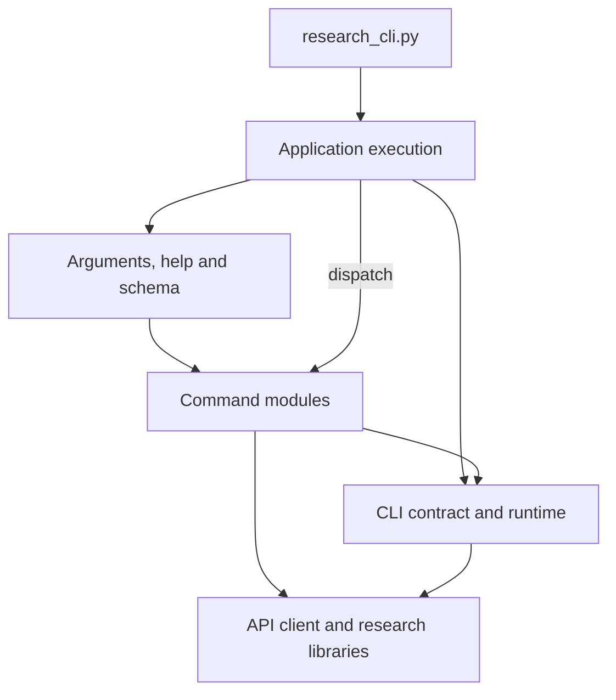

# Alpha Machine

Tools for researching [WorldQuant BRAIN](https://platform.worldquantbrain.com/)
alphas: generate FASTEXPR expressions, simulate them, and read back which ones
scored well.

The repository is built around one idea: **a program should be able to drive the
whole loop without reading the source.** Every capability is reachable from
`research_cli.py`, whose contract is documented by the tool itself.

```
python research_cli.py brief                # current evidence and source paths
python research_cli.py help                 # concise command map, when needed
python research_cli.py schema catalog fields # one command's machine contract
```

## Layout

| File | Job |
| --- | --- |
| `research_cli.py` | Thin executable entry point. stdout is always one JSON document. |
| `research_app/app.py` | Command execution, workspace selection, error envelopes and exit codes. |
| `research_app/parser.py` | Argument declarations, terminal help and the schema derived from the live parser. |
| `research_app/runtime.py` | Shared CLI contract, JSON output, input settings and authenticated sessions. |
| `research_app/account.py` | Account access and local cache commands. |
| `research_app/catalog.py` | Dataset, datafield and operator discovery. |
| `research_app/validation.py` | Expression lint and simulation preflight checks. |
| `research_app/experiments.py` | Simulation, resumption, labelled probes, ablation and comparison. |
| `research_app/alphas.py` | Platform alpha inspection, metadata, submission and correlation. |
| `research_app/ledger.py` | Local ledger recording, labels, lineage, coverage, shared legs and offline queries. |
| `research_app/campaign.py` | Research briefs and train/test view history. |
| `research_app/literature.py` | Web literature search and OpenAlex paper discovery. |
| `research_config.py` | Research-file format: parsing and validation, shared by CLI and research scripts. |
| `machine_lib.py` | BRAIN API client + FASTEXPR factory helpers. No printing, typed errors. |
| `expression_lint.py` | Pre-flight checks: real operator names, arity, learned rejections. |
| `expression_types.py` | Five field types, operator signatures, and the mismatches they imply. |
| `field_index.py` | Live field-name verification and vocabulary-free variant grouping. |
| `field_search.py` | Ranked local search over fields and operators: AND, exclusion, fuzzy. |
| `deepseek_search.py` | Literature search and page fetch, so an idea can be checked against the paper. |
| `paper_search.py` | OpenAlex paper search: journal, DOI, citations, reconstructed abstract. |
| `field_contract.py` | Field contracts: declared vs inferred period/unit/sign, verdicts. |
| `research_paths.py` | Resolves where results go -- always outside this working tree. |
| `alpha_registry.py` | Append-only ledger of alphas worth remembering. |
| `correlation.py` | Align daily PnL on shared dates, Pearson, residualise against a control. |
| `ablation.py` | Leave-one-out and solo variants, so a leg can be shown to earn its place. |
| `cache_store.py` | Small JSON cache with TTL, so repeat calls do not re-fetch. |
| `fastexpr_ast.py` | FASTEXPR parser: tree, field extraction, skeletons, transforms. |
| `alpha_sugar.py` | Sugar that compiles to FASTEXPR (`band`, `rrank`, `deadband`, ...). |
| `operator_semantics.py` | Invariants the operator catalogue does not publish. |
| `annotations.py` | `@annotation` vocabulary, staleness checks, ablation derivation. |
| `intent.py` | Rewrite "rank a level" into "rank a level over size". |
| `alpha_unit.py` | Compress the ledger into constructions: template, grid, derivation. |
| `expression_units.py` | Field units, harvested from the simulator's rejections. |
| `rejection_reasons.py` | Why a rejection happened: the cause, not just the gate. |
| `tools/guarded_sim.py` | Simulate only after the catalogue check; refuses unknown names. |
| `tools/probe_units.py` | Measure a field's unit from the simulator's own rejection. |
| `research_app/substitution.py` | Whole-token field substitution: the "change exactly one input" batch. Exact and identifier-bounded, because `replace("sales", ...)` also rewrote `sales_growth`. |
| `tools/cluster_ledger.py` | Group the ledger by PnL correlation or by shared datafields. |
| `tools/dedupe_ledger.py` | Find identical-PnL entries that are one alpha filed twice. |
| `tools/degenerate_batch.py` | Flag a batch whose different expressions produced the same result. |
| `tools/derive_family.py` | Derive family labels from the datafield namespace. |
| `tools/unit_report.py` | How few constructions the ledger is, and what each has not tried. |
| `tools/parts_catalogue.py` | Reusable parts, screened by how many book families they serve. |
| `tools/backup_replay.py` | Snapshot the research directory; replay it as of a date; diff drift. |
| `tests/` | Offline contract tests. No account required. |

`docs/tooling.md` maps these to the question each one answers. There are 18 of them
because eight were removed on 2026-11-01 for being superseded or one-shot -- see the
note at the top of that file before adding a nineteenth.

**This repository versions the tool, not the research.** Simulation results,
field-catalog snapshots, the alpha registry and the learned operator denylist
all live in a results directory outside the working tree, resolved by
`research_paths.py`:

1. `$BRAIN_RESEARCH_DIR` if set;
2. otherwise `<persistent workspace>/worldquant-research` (`/data/worldquant-research`
   on this deployment -- `$HOME` is often an ephemeral container layer, and a
   registry that evaporates is no better than one never written);
3. otherwise `$XDG_DATA_HOME/worldquant-research`, then `~/.local/share/worldquant-research`.

`research_cli.py schema` reports the resolved path under `research_paths`. A
`research/` directory inside the repo is git-ignored as a guard rail, so a stray
run cannot quietly add data to the history.

Examples use placeholder alpha IDs and synthetic or qualitative case data. BRAIN's
metric definitions, platform thresholds, field/operator names and general concepts
remain literal; private account observations belong in the research directory.

## Application boundaries



Command modules return data or raise a typed error; the execution boundary owns
stdout, saving, workspace overrides and exit codes. The parser binds handlers
explicitly and generates help/schema from those same declarations.

Each CLI invocation restores the caller's diagnostic handler, metadata cache policy
and workspace settings when it exits, including on command failures.

The root libraries (`machine_lib`, `research_config`, `alpha_registry`, the expression
and field modules) implement reusable research behavior and never import the CLI
application. Add a command in its owning module, declare its arguments in
`research_app/parser.py`, and test the implementation module or the executable
contract. The entry point exports no command handlers or compatibility aliases.

`research_app` adds internal modules, with no additional tool entry points. Probes
import `tools.guarded_sim` directly; command execution does not change the module
search path to locate it.

## The expression tree

`docs/ast-pipeline.md` explains why FASTEXPR is parsed into a tree, which operations
need structural parsing, and which can keep their existing implementation. Read
it before changing anything that extracts information from an expression by
pattern-matching the string.

## Documentation

Four pages, each written to stop a specific mistake being repeated:

| Page | Read it when |
| --- | --- |
| `docs/tooling.md` | you are about to add a tool, or cannot remember which one answers a question |
| `docs/ast-pipeline.md` | you are about to inspect an expression with a regex |
| `docs/unit-compression.md` | you want to know how many constructions there really are, and what each has not tried |
| `docs/backup-replay.md` | you are about to trust a number, or touch the research directory |

The pattern in all four is the same: measure first, record what was measured *and
rejected*, and state the number with its unit, because the counts in prose go stale
and the reasons do not.

## Install

```bash
pip install -r requirements.txt      # required: requests
```

`pandas` is imported only when `fields_to_df()` is called. Install it separately
for DataFrame helpers or notebooks:

```bash
pip install "pandas>=2.0"
```

The CLI, list-based field processing and submission checks run without it.

## Credentials

Copy the template and fill it in:

```bash
cp .env.example .env
```

`.env.example` is the single list of variables this tool reads: required credentials,
the research directory, the literature-search key and its alias, and the two tuning knobs.
It is guarded by a test that extracts environment names from the source, because that list
had already drifted once - four variables were documented nowhere, including the one that
decides where the ledger lives.

`.env` must sit next to `machine_lib.py`; the loader resolves it relative to the module,
so a `.env` elsewhere is silently ignored. It is git-ignored. Real environment variables (`BRAIN_USERNAME`,
`BRAIN_PASSWORD`) take precedence over the file:

```bash
export BRAIN_USERNAME=you@example.com
export BRAIN_PASSWORD=...
```

`machine_lib.get_credentials()` raises `MissingCredentials` when either is
absent — nothing silently sends an empty login.

BRAIN sessions last hours but challenges rapid repeated logins with a captcha,
so the session cookie is cached and reused. It lives in
`<research_dir>/cache/session.json` — outside the git working tree, mode `0600`,
written atomically so a killed run cannot leave a truncated file behind.
Concurrent CLI calls take a file lock and share one login instead of racing
each other into a captcha. Use `--relogin` to force a new login, `--no-cache` to
ignore the cache for one call, or `auth logout` to forget it.

Catalog metadata (operators, fields, datasets, categories, operator docs) is
cached too, under `<research_dir>/cache/metadata/`. It is quota-free but slow —
the USA field catalog is 4367 rows over fourteen paginated calls — and it
changes on the order of days. Default TTL is 24 h (`--meta-max-age`, or
`BRAIN_METADATA_TTL=0` to disable); `--refresh-meta` refetches. Every catalog
response carries a `cache` report (`hit`, `age_seconds`,
`expires_in_seconds`), and if a refetch fails while an older snapshot exists the
cached copy is served with `stale: true` instead of failing the command.

```bash
python research_cli.py cache info                  # what is cached, how stale
python research_cli.py cache clear --kind metadata # drop catalog snapshots
```

## Driving it from a script or an agent

stdout is **always exactly one JSON document**, so every call is:

```python
result = json.loads(subprocess.run([...], capture_output=True).stdout)
if not result["ok"]:
    handle(result["error"]["code"], result["error"]["message"], result["error"]["hint"])
```

Progress goes to stderr, never stdout. Failures carry a stable `error.code` and
a process exit code (`USAGE`/`INVALID_INPUT` 2, `AUTH_*` 3, `RATE_LIMITED`/
`SERVICE_ERROR` 4, `NOT_FOUND` 5, `SIMULATION_FAILED` 6).

A failure can also carry `error.details`: the structured findings behind it, for
example every lint error per expression, so a caller can act without scraping the
message text.

### Discover the surface

```bash
python research_cli.py                         # concise guide
python research_cli.py help catalog fields     # examples and options for one task
python research_cli.py catalog                 # commands available in this group
python research_cli.py catalog fields --help   # terminal help, including defaults
python research_cli.py schema                  # full contract for tooling integrations
python research_cli.py schema alpha get        # just one command's contract
```

Common options work before or after any command: `--save PATH` creates missing parent
directories and atomically writes **the same complete JSON envelope as stdout**, including
failures; `--save -` uses stdout only. The destination is checked before execution.
`--compact` emits one line, `--quiet` suppresses progress while keeping errors, and
`--research-dir PATH` overrides the research directory for this invocation.

```bash
python research_cli.py --research-dir ./research ledger list --family quality
python research_cli.py simulate sample-batch.json --dry-run --compact --save preview.json
```

In CLI 3.0, local records live under `ledger`: `ledger list` combines the former
`alpha registry` and `alpha find` filters. `record`, `label`, `impact`, `lineage` and
`coverage` also moved from `alpha` to `ledger`. `alpha` reads or updates the platform;
`ledger` works locally except for `ledger record`, which fetches the selected alpha.

### Start a session with one bounded document

```bash
python research_cli.py brief             # book, recent scores/setbacks, questions and source paths
python research_cli.py brief --days 30 --top 10
```

It answers "where does the research stand" from the ledger, the result directory and
`open-threads.md`. `research_dir`, `ledger.path` and `threads.path` identify the sources;
the `exists` flags distinguish missing files from empty ones. An empty local workspace
does not establish that a direction has never been tried.

`recent.best` contains score leads with family/mechanism labels, measured inside the
train window; records without train metrics stay out of `best` and appear in
`missing_train_metrics`. `recent.setbacks` adds recorded `rejected`, `falsified` and
`no_go` decisions, including later relabels.
Its `count` covers all such records in the window; `items` takes the newest representative
per family/mechanism/verdict, using the record key when a mechanism is missing. These
are examples to investigate, not an estimate of failure rates or independent bets.

`--top` must be at least 1 and bounds each score, setback, write-up and thread list.
Threads retain file order and report their full `counts`; put current questions first.
Long question, idea, mechanism and note previews are capped at 240 characters, with `…`
marking truncation. Use the source path and ledger key to recover complete evidence
before interpreting a clipped conclusion.

Maintain one `- [open] **question** — evidence; next discriminating check` or
`- [closed] **question** — conclusion; evidence; reopening condition` per line in
`open-threads.md`. Keep detailed evidence in the linked ledger records and reports.
For the explore → select → experiment → review workflow, see
[the information flow guide](docs/tooling.md#给-ai-的信息按阶段进入).

### Retrieve independent questions concurrently

```bash
python research_cli.py feed --from-threads --workers 4 --timeout 30 --dry-run
python research_cli.py feed --topic "analyst revisions" --topic "earnings quality" --action
```

`--workers` bounds concurrent queries (1–8, default 4); `--timeout` bounds each network
request. Output retains topic order and balanced picks regardless of completion order.
`next_actions` supplies bounded, evidence-linked retries, deferred searches, source reviews
and contrasts. Its `argv` lists are arguments for `research_cli.py`, not shell strings.
Threads may state an authored query with `; query: ...`, including after a Chinese heading.

Paper caches use the effective request under `<research>/cache/papers/`; web-search caches
also distinguish content and original-question options. Identical concurrent misses share
one fetch; writes are atomic, expired/corrupt entries refetch, and failed cache writes do
not discard successful retrievals. Paper records preserve available landing-page/PDF links.

Concurrent feeds reread seen state under a lock after retrieval. Drafts commit before seen;
each file is atomic, but a crash between commits can repeat drafts, and a crash after seen
commits can consume picks before delivery. Dry-run leaves seen/drafts alone; caches may write.


### Check the account

```bash
python research_cli.py auth check
```

Returns `user_id`, `permissions` and the regions that actually have data. A
`TUTORIAL` account only sees `USA` — every other region returns zero datasets.

### Browse metadata (quota-free)

```bash
python research_cli.py catalog operators --search ts_ --group "Time Series"
python research_cli.py catalog categories                 # field/alpha counts = crowding
python research_cli.py catalog datasets --region USA
python research_cli.py catalog fields --dataset fundamental6 --type MATRIX \
    --search liability --limit 20 --expressions
```

`--expressions` also emits ready-to-paste snippets, already winsorized and
backfilled. Add `--save out.json` to keep a snapshot for offline use.

`--search` is ranked, not a substring filter, and it runs locally over the
fetched catalogue so it can do what the endpoint cannot:

```bash
python research_cli.py catalog fields --dataset analyst4 --search "cfps number"
python research_cli.py catalog fields --dataset analyst4 --search "cfps -median"
python research_cli.py catalog operators --search "rank ts" --any-term
python research_cli.py catalog fields --dataset fundamental2 --search cfpps --fuzzy
```

Multi-word queries are AND, `-word` excludes, `--any-term` relaxes to OR, and
`--fuzzy` tolerates one edit. Hits carry `score` and `matched_terms`, so the
ordering is explainable. When nothing matches, the reply names the `absent_terms`
rather than quietly relaxing the query — assuming two words are synonyms is the
one thing this search refuses to do.


### Check field names and compare variants (quota-free)

```bash
python research_cli.py catalog verify --fields cfps_mean,anl4_afv4_cfps_mean --strict
python research_cli.py catalog concepts --dataset analyst4 --search cfps --min-spread 0.1
```

`catalog verify` answers one question: does this identifier exist in the live
catalog for this scope? A name typed from memory is not an operator, so the
operator catalog cannot see it, and the first symptom is a simulator error after
the submission has been spent. `simulate` now runs this check itself before
submitting anything and refuses to start on an unknown name.

`catalog concepts` groups fields that differ only in family boilerplate and shows
their coverage side by side. Two ids for the same quantity can differ by a third
of the universe, and nothing in the ids says so, so the choice is made on the
number. The grouping carries **no built-in vocabulary**: `--tail-tokens N`
compares only the trailing words, `--ignore-words` drops words you name, and
`--drop-numeric` ignores vintage numbers. Nothing about BRAIN's naming is
hard-coded, so the tool cannot rot into mis-grouping after a family is renamed.


### Simulate

Always validate before spending quota:

```bash
python research_cli.py simulate --expr "rank(liabilities/assets)-0.5" --decay 4 --dry-run
```

`--dry-run` prints the exact `POST /simulations` payloads without contacting
BRAIN, so it needs no credentials.

Then run for real:

```bash
python research_cli.py simulate sample-batch.json --sort sharpe --top 5 --stream
```

`--stream` emits JSON Lines progress events on stderr (`submitted`, `completed`,
`rate_limited`) while the single JSON result stays on stdout. The result
contains one record per expression (`expression`, `decay`, `alpha_id`,
`status`, `metrics`, `checks`, `error`) plus a `summary` with counts, a
`ranking` sorted by sharpe, and `best`.

Simulation commands have a 5-minute wall-time budget by default. If a server
`Retry-After` would exceed that budget, the command returns `PENDING` rather
than sleeping past the four-hour session-cache lifetime. Accepted jobs and
unsubmitted expressions are atomically saved in a mode-0600 checkpoint under
`.brain_checkpoints/` (or the path passed to `--checkpoint`); continue later
with `python research_cli.py resume <checkpoint>`. Resume polls accepted jobs
before submitting any queued work, so it does not duplicate already accepted
simulations. `--max-wait-seconds` adjusts the budget for either command.

A failed expression is reported in its own record instead of aborting the run;
the command only fails outright when *every* expression failed.

### Probe a labelled experiment

Use one spec for a batch of arms and their settings:

Every controlled experiment has exactly one arm marked `design: "control"`.
Other arms use `add`, `drop`, `parallel` or `rescue`: add/drop/rescue keep the
control's effective settings; parallel changes exactly one setting; rescue also
names `proxy_of`. Validation uses resolved settings, including CLI overrides and
explicit arm decay. A scan declares `"design": "explore"` at the spec's top level:

```json
{"name": "sample-batch", "design": "explore", "settings": {"decay": 4},
 "arms": [{"label": "subindustry", "expression": "rank(close)"},
          {"label": "industry-fast", "expression": "rank(close)", "decay": 2,
           "settings": {"neutralization": "INDUSTRY"}}]}
```

```bash
python research_cli.py probe sample-batch.spec.json --dry-run
python research_cli.py probe sample-batch.spec.json
```

`probe --dry-run` is a fully offline preview: it loads no session or credentials,
contacts no catalog, and spends no simulation quota. It validates every settings
group, resolves defaults and per-arm decay, and returns the complete settings and
exact `POST /simulations` payload for each labelled arm in `results`. Structural
lint and the learned denylist run locally; `blocking` lists their errors. The
`lint` report explicitly marks the live operator and field catalogs as unchecked.
Use `lint` when you need authoritative catalog checks.

A real probe validates every group locally before loading a session or submitting
anything, then runs the existing catalog guard for each simulation group. Arms
with equivalent resolved settings and decay share a group. Results and ledger
entries retain each arm's actual settings and decay. The table and `rows` show
train-period metrics by default; `--show-test` also reveals the full-window and
test metrics, failing checks, and records that view. `comparisons` reports each
arm minus its control on train metrics, with missing evidence listed under
`unavailable`; explore batches report no attribution. Spec `idea`, `mechanism`
and `note` travel with the preview, batch file and summary. Existing batch files
are protected before simulation; choose another `--name` or pass `--force`.

`--strict-gate` refuses only an arm whose canonical expression and complete
effective settings already have a finished result in the registry. A dry run
shows `gate_blocking` / `would_block` and the prior evidence keys; structural
similarity is reported separately and never blocks.

`probe` accepts the same settings and session flags as `simulate`. Explicit settings
override the spec and each arm's settings; an arm's top-level `decay` remains its
per-expression override. One real batch shares a session across all groups.
Use `probe - --dry-run` to read a spec from stdin.

Probe batches are saved before submitting and after each progress/result event, including
accepted progress URLs. `--max-wait-seconds` bounds simulation waiting across groups
(default 300); unfinished jobs stop later settings groups from submitting. Use
`probe --recover sample-batch.json` to read known IDs/progress URLs without resubmitting, and
`resume CHECKPOINT` for simulation checkpoints. Recovery persists each result and reports
`not_submitted` arms separately. Same-batch writers and same-checkpoint resumes are locked;
Windows and POSIX release ownership when the process exits. A complete batch recovers offline.


### Inspect results

```bash
python research_cli.py alpha get ALPHA_ID
python research_cli.py alpha list --min-sharpe 1.5 --limit 20
```

Both are quota-free.

`alpha list` filters on `status=UNSUBMITTED` by default, so it will not show
what you have already submitted. Read the live book with:

```bash
python research_cli.py alpha list --status ACTIVE --limit 30
```

Or ask for the book directly — it joins each submitted alpha with the ledger's
mechanism label, and can report how a candidate would sit against it:

```bash
python research_cli.py alpha book
python research_cli.py alpha book --check ALPHA_ID
```

### Check the ledger before spending a simulation

The most expensive mistake in this workflow is re-testing a field that was
already falsified. `ledger list` answers that offline, with no network call:

```bash
python research_cli.py ledger list --field anl4_cfo_number
python research_cli.py ledger list --mechanism revision --verdict rejected
```

`already_tested: true` in the output means a prior entry mentions that field;
read its verdict and metrics before writing a new expression.

Verdicts are not all failure states:

| verdict | meaning |
|---|---|
| `candidate` | passed the gates; keep it |
| `watch` | interesting but below threshold, or correlation unverified |
| `rejected` | the expression underperformed; the hypothesis was never on trial |
| `falsified` | a pre-registered hypothesis was tested with controls and the controls won — a result, not a failure |
| `no_go` | abandoned before a fair test (data blocked, unusable fields) |

`falsified` is the one worth protecting: it is what stops a later round from
re-opening a mechanism that was already ruled out, so put the deciding control
in the note.

### Mechanism labels overstate diversity — read the family count

`mechanism` is specific on purpose: one label per construction. Multiple labels can
describe variants of the same underlying exposure, so label counts alone do not
establish diversity.

`family` is the declared second level (`oi`, `quality`, `leverage`, `option`,
`analyst`, `event`, `reversal`, `momentum`, `attention`, `other`) and it is
never inferred: a keyword guess would label an analyst forward-EPS alpha as
`analyst` when it is really a `quality` bet.

```bash
python research_cli.py alpha book           # book_size / mechanism_count / family_count
python research_cli.py ledger list --family quality
```

Use `family_count` to group declared research families and `mechanism` to distinguish
constructions. Neither count proves independence; inspect daily PnL as well.

### Read the checks that matter (including self-correlation)

`alpha get` returns the **cached** check snapshot embedded in the alpha body,
where `SELF_CORRELATION` is usually `PENDING` or missing. That is a caching
artefact, not a permission limit: `GET /alphas/{id}/check` triggers the
computation and replies with `Retry-After` until the job finishes.

```bash
python research_cli.py alpha check ALPHA_ID          # compute and print live checks
python research_cli.py alpha check ALPHA_A ALPHA_B --workers 2 --max-wait 300
```

One or several IDs use the same response shape: `count`, `results`, `complete` and
`summary`. IDs are deduplicated in first-seen order; results retain that order even
with concurrent workers (`--workers` accepts 1–3, default 1). Each row separates
`status` (`complete`, `pending`, `error`) from `outcome` (`passed`, `failed`,
`warning`, `pending`, `error`). A resolved `FAIL` is complete evidence of failure;
missing or unresolved checks keep the row incomplete. A row can therefore have
`outcome: failed` while another check still leaves `status: pending`.

Top-level `complete` requires every row to be complete. `summary` counts status
values and the `passed` / `failed` / `warning` outcomes; it is not a pass count
disguised as completion. An individual request error stays in that row's `error`
and does not discard other results. `--max-wait` is the async-check wait budget
for each alpha (default 180 seconds), not a shared budget for the batch.

### Check self-correlation locally, and correctly

```bash
python research_cli.py alpha self-check ALPHA_ID
python research_cli.py alpha self-check ALPHA_ID --as-of 2026-01-01T00:00:00Z
```

Daily Pearson provides the local correlation estimate. Weekly and monthly
aggregation are diagnostics because changing the sampling window changes the
quantity being compared.

Local/platform calibration must use the same peer set and observation time.
Otherwise book growth can look like measurement bias. `classify()` applies its
configured bias and margin when producing a local verdict; calibration parameters
are model assumptions, not platform thresholds or a guarantee of submission.

The peer set and timing are part of the evidence:

* **Include in-flight submissions.** Recent candidates can share exposure even
  when they are absent from the platform's current ACTIVE snapshot. Local checks
  include recent candidates by default (`--include-unsent-hours`, default 24).
* **A published platform value is historical.** A later book can contain new
  counterparts. `--as-of` restricts peers to the submission cutoff so the comparison
  uses the intended historical set. Parse timestamps with their timezones instead
  of comparing timestamp strings.
* **A peer with no number is a gap, not a zero.** A flat PnL series has no Pearson
  correlation with anything, and a peer whose PnL has not been written yet has no series
  at all. Both are listed in `peers_unmeasured` with a reason (`undefined`, `no_pnl`,
  `short_overlap`). `clear` is a claim about every peer, so one gap downgrades the verdict
  to `unknown`; `blocked` and `borderline` stand, because missing evidence can only add a
  reason to refuse.

The report says so explicitly when the counterpart entered after the candidate
(`counterpart_entered_after_candidate`), instead of leaving a number that looks like a
disagreement with the platform.

### Submission is locked by default

Real submissions are refused unless `.env` (or the environment) contains exactly:

```
ALLOW_AGENT_SUBMIT=true
```

Unset, empty or `false` all leave the lock closed, and so does every other spelling — `1`,
`yes`, `TRUE`, `on`. Surrounding whitespace is forgiven, because a stray space says nothing
about intent; anything else is ambiguous, and ambiguity resolves to "no".

With the lock closed the CLI still backtests, runs the platform's checks and analyses
self-correlation. It refuses only the one irreversible action, before it touches the network:

```json
{"ok": false, "command": "alpha", "error": {
  "code": "SUBMIT_DISABLED",
  "message": "submission is disabled: ALLOW_AGENT_SUBMIT is not 'true' ...",
  "hint": "this is a policy lock, not a failure: set ALLOW_AGENT_SUBMIT=true ..."}}
```

Exit code `7`, distinct from a service error, so a caller can tell "policy says no" from
"something broke" and stop asking instead of retrying.

### Submit (and the "test submission")

There is **no separate test-submission endpoint**. The pre-submission test *is*
the check flow above; the only write action is `POST /alphas/{id}/submit`.
`alpha submit` therefore defaults to a dry-run that runs the live checks and
reports the correlation that would decide the submission, and only writes with
`--yes`:

```bash
python research_cli.py alpha submit ALPHA_ID          # dry-run, nothing written
python research_cli.py alpha submit ALPHA_ID --yes    # irreversible
```

An alpha also carries metadata, and a submission is unattributable without it. `name`,
`category` and `tags` are top-level properties; `description` is writable too but **nested
under `regular`** — `{"regular": {"description": ...}}`. Eighteen *top-level* spellings all
returned `Unexpected property` and the conclusion drawn was that the field did not exist;
it was the shape that was wrong. `alpha submit` refuses an alpha with no name or category
and prints the exact command to fix it.

```bash
python research_cli.py alpha describe ALPHA_ID \
    --name "Sample research candidate" --category FUNDAMENTAL
```

Categories are an enum discovered by probing, because an invalid value returns 400 without
listing the choices: `ANALYST`, `FUNDAMENTAL`, `PRICE_VOLUME`, `SENTIMENT`, `VOLUME`.

### What "submitted" actually means

Three outcomes look similar and are not:

| response | meaning |
| --- | --- |
| `403` with a check list | evaluated and refused; only here do you learn the real value |
| `201` with an empty body | accepted for asynchronous evaluation; **not** a submission |
| `dateSubmitted` set | the only trustworthy evidence that it went in |

A first `POST` may return before asynchronous evaluation finishes. A later check
can still refuse the candidate. Always confirm with `dateSubmitted`, never with
the initial status code alone.

`alpha submit` therefore reports a four-state `submission` field instead of a boolean:

| `submission` | meaning |
| --- | --- |
| `CONFIRMED` | `dateSubmitted` is set; it is in the book |
| `ACCEPTED` | the platform took the request but `dateSubmitted` is still empty - re-check before counting it |
| `REJECTED` | refused, with `failed_checks` naming what failed and its value |
| `UNCERTAIN` | accepted, but the read-back failed; the outcome is unknown |
| `NOT_SENT` | dry run, nothing was written |

`submitted` is true only for `CONFIRMED`. An HTTP status below 400 alone does not
establish that the alpha entered the book.

The platform's own view names the counterpart, which is what makes the substitute route
decidable:

```bash
python research_cli.py alpha self-corr ALPHA_ID
```

The report includes the candidate's Sharpe, maximum correlation, required Sharpe,
verdict and counterpart details. These are live evidence for the selected alpha;
private result snapshots belong in `research_dir`.

The margin applies to **every** counterpart above the limit, not to the most-correlated
one — taking the counterpart of the maximum understates the bar exactly when a second,
higher-Sharpe neighbour exists. Two related traps are handled rather than discovered:
`/correlations/self` answers `200` with an empty body plus `Retry-After` when it is not
ready (a blank body is retried, because reading it as "no data" reports a correlated alpha
as clear), and the recordset we use is `/recordsets/daily-pnl`, which is already daily, so
the documented requirement to difference a cumulative series does not apply here.

### Dimensions: do not add market cap to a balance-sheet item

`cap + abs(liabilities)` is refused by the simulator: market capitalisation carries
`Unit[CSPrice:1,CSShare:1]` — price times shares — while total liabilities is dimensionless
in this catalogue. Check the measured units before combining these quantities.

`lint` now says so first:

```
unit_mismatch: infix arithmetic mixes cap (Unit[CSPrice:1,CSShare:1]) with
abs(...) (dimensionless); the simulator refuses operands of different units.
Divide by a common scale instead of adding.
```

The units are **measured, never assumed**: `tools/probe_units.py` reads them out of the
simulator's own rejection message, and an error observed at simulation time is recorded in
the same cache. A field with no measurement yields no finding — the same rule the type
checker follows, because a guess that misfires trains the operator to ignore the check.

Scope is deliberately narrow: additive operators and comparisons must see two operands of
one unit, which is exactly the class that costs a round trip. Multiplication and division
combine units so a nested expression can still be judged; a fractional exponent drops the
unit rather than inventing a square root.

Two details were learned by getting them wrong. The first version only matched the function
form `add(a, b)` and stayed silent on `a + b`, which is the form that failed. And infix
splitting has to treat a leading `-` as unary, or `-rank(close) - 0.5` looks like a
mismatch.

### The turnover floor, checked mechanically

Disclosure fields can express useful mechanisms, but a construction driven only by
infrequent filings may not clear the platform's 0.01 turnover floor. A leg that
reprices daily can change that behavior; it still needs simulation and validation.

`lint` reports `turnover_floor_risk` when a disclosure-only construction lacks a
market-driven leg. This is a structural warning about update cadence, not a stored
performance result or a reason to discard an entire data family.

The check reads **which fields carry market data**, taking that from the catalogue's
dataset rather than from a list of names. Its subject is the expression, not the field: the
finding says "add the leg", never "avoid the data". The first attempt keyed on "has a time-series
operator" and was wrong in both directions: `ts_backfill` is a fill, not movement, so a
static ratio passed silently; and `close/vwap` has no window at all, so a shape that turns
over hundreds of times a year was flagged.

It is a warning, not an error: a low-turnover signal is legal, it simply cannot pass. The
dataset split lives in one visible constant (`DISCLOSURE_DATASETS`, named for the release
cadence rather than for any judgement about value) instead of being inferred inside the
linter, so the assumption can be read and argued with.

### Types: five kinds of field, and the operators that accept them

The platform's field filter offers five types — `Matrix`, `Vector`, `Group`, `Universe`,
`Symbol` — and an operator accepts specific ones. `expression_types.py` carries the
signature table and checks arguments against it:

```python
rank(five_minute_price_change_pct)              # type_mismatch: rank expects MATRIX
rank(vec_avg(five_minute_price_change_pct))     # ok: the vector reducer returns MATRIX
multiply(five_minute_price_change_pct, 2)       # type_mismatch
group_rank(close, close)                        # type_mismatch: the group slot wants GROUP
group_rank(close, subindustry)                  # ok
group_rank(close, bucket(rank(close)))          # ok: bucket returns GROUP
densify(close)                                  # type_mismatch: densify wants GROUP
```

This replaces a hand-built denylist of "operators that reject VECTOR fields", which had
been assembled from simulator error messages and was necessarily incomplete. The rule is
now derived: only `vec_avg` and `vec_sum` accept a VECTOR, so everything else is a type
error by construction. The denylist survives only for operators the table does not cover,
so the same problem is never reported twice.

Two details worth knowing:

* `bucket` returns a **GROUP**, not a number. That is why it can be passed to a group
  operator and nowhere else, and it is the documented way to build a custom grouping.
* operators that the course material or the formulae paper documents but this account's
  catalogue lacks — `vec_choose`, `ts_max`, `ts_min`, `floor` — are reported as
  `operator_documented_unavailable` with that reason, instead of a generic unknown-operator
  error. `vec_choose` in particular appears in WorldQuant's own short-interest example and
  cannot run here.

Inference is deliberately pragmatic: a bare field resolves to its declared type, a call to
its return type, a literal to scalar, and anything else to the first typed piece inside it
or `UNKNOWN`. It stays silent rather than guessing, so a variable assigned earlier in the
expression is not mistaken for a type error.

### Lint before you spend a simulation

```bash
python research_cli.py lint 'rank(ts_delta(close, 5))'
python research_cli.py lint --file sample-batch.json --dataset fundamental6
python research_cli.py lint --offline 'rank(close)'      # no account needed
```

The operator names in an expression are checked against `GET /operators`, the
authoritative list -- not the documentation site, which describes operators the
simulator does not accept. (`regression_neut` is the cautionary example: a docs
page exists, the operator does not.) `simulate` runs the same check before
submitting and refuses to spend quota on an expression that cannot work; pass
`--allow-lint-errors` to override. Exit code is `2` on a lint failure and the
error envelope carries every finding under `error.details`.

Online `lint` and simulation preflight derive field names, types and market/disclosure
classification from one scoped field-catalog fetch per check. Both reject a raw
VECTOR passed to `rank`; reduce it first, for example `rank(vec_avg(vector_field))`.
`tools.guarded_sim` uses the same field enumerator. Offline lint skips live metadata
and authentication.

Rejections the simulator reports are written back to
`<research_dir>/operator-denylist.json` with a severity: `block` when the operator
is unknown or unavailable, `warn` when it merely rejects that kind of input (for
example `subtract` refusing event inputs). The file persists across sessions, so
the lesson survives even though it is not in git.

### Audit a field set before combining fields

```bash
python research_cli.py catalog field-audit \
    --fields fnd6_newa1v1300_capx,fnd6_newa2v1300_oancf,fnd6_newa1v1300_at \
    --operation ratio
```

The catalog tells you a field's coverage and delay; it does not tell you the
unit, the currency, the fiscal period, the sign convention or how corporate
actions are handled. Those unknowns -- not the economics -- are what sink ideas,
so they are made explicit per field as `declared`, `inferred` (with the rule that
produced it) or `unknown`, and the operation is then judged:

| verdict | meaning |
| --- | --- |
| `ready` | period and unit are known and consistent; no caveats |
| `needs_review` | usable, but fiscal alignment or sign convention is unverified |
| `blocked` | a critical attribute is unknown; do not compute on it yet |

Operations: `ts_difference` (one field over time), `ratio`, `difference`, `sum`.
Differencing a share count is blocked outright because no split basis is
declared; a sum or difference of fields with undeclared sign is blocked because
one negative stored value inverts the signal. Quota-free.

### Measure a unit instead of guessing it

The catalogue does not declare units, and `field-audit` can only say `unknown`. There is
one way to find out: add the field to a pure number and read the rejection.

```bash
python tools/probe_units.py --fields fnd6_newqv1300_invfgq,fnd6_newqv1300_invwipq
```

```
fnd6_newqv1300_invfgq   Unit[TSPrice:1]   simulator named the field unit as expected
fnd6_newqv1300_invwipq  dimensionless     add with a scalar succeeded
```

Answers are cached in `<research_dir>/field-units.json` so a probe costs one simulation
only once. Two details are easy to get wrong and both are pinned by tests:

* the simulator reports `expected "Unit[TSPrice:1]", found "Unit[]"` — the **expected**
  side is the field and the **found** side is the bare scalar, so reading `found` inverts
  every answer;
* a unit mismatch can arrive as `WARNING` as well as `ERROR`, so the error text is
  inspected before the status.

This distinction is worth acting on: `unknown` is a prompt to measure, `absent` is a
reason to stop. A measurable unknown needs evidence before a mechanism can be judged.

## Templates: use units, not macros

A template with slots is `alpha_unit`'s job: every expression in the ledger already
decomposes into a template plus a filling, and the unit also knows which grid points
were never run. `python3 tools/unit_report.py --derive <key>` lists them. The old
text/tree macro system that did the same thing by hand-written `def` blocks was
removed because unit templates also track derivations and coverage. Keep private
experiment plans and their outcomes in the research directory.

### Report the pool as a distribution

A best-alpha report hides what a pool is: two pools can share a top result and differ
completely in spread, one narrow and correlated, one broad and independent.

Use `python research_cli.py health --pool` to inspect the current pool. Compare the
distribution of Sharpe, turnover, holding days and pairwise correlations, rather
than quoting only the best alpha. Shared PnL can reveal concentrated exposure
despite distinct names or expressions. Percent-of-capital volatility requires
capital data; an unavailable denominator must not be replaced by an invented one.

#### Forecast fields: frequency is not target period

`period` answers "how often is this estimate produced". It does not answer "which fiscal
year does this observation target", and the catalog never says. The contract therefore
carries two more attributes, kept deliberately separate:

```json
"target_fiscal_period":         {"state": "unknown", "evidence": "none"},
"historical_target_alignment":  {"state": "unverified", "lookback": 63}
```

The consequence is a verdict change: `ts_difference` over an analyst forecast field now
returns `needs_review` with `target_fiscal_alignment_unverified`, where it used to return
`ready` as soon as the frequency was known. A 63-day difference of an annual estimate is
not necessarily the revision of one forecast — it can be a comparison across a fiscal-year
rollover, and reading it as a revision invents a signal.

The flag is narrow on purpose: the analyst dataset and the `anl4` prefix. Differencing a
reported accounting figure is unaffected, because blocking the whole field catalogue would
trade one mistake for a worse one.

### Remember what you found

```bash
python research_cli.py simulate sample-batch.json --record --idea "Sample hypothesis" \
    --mechanism "sample mechanism"
python research_cli.py ledger record ALPHA_ID --idea "Sample hypothesis" \
    --verdict candidate --note "why it mattered"
python research_cli.py ledger list --format markdown --min-sharpe 1.25
```

`<research_dir>/alpha-registry.jsonl` is an append-only ledger, one alpha per
line, kept outside git so findings outlive a chat window without turning the
repository into a data dump. Back that file up like any other result; it is the
durable memory of the research. Each entry is self-contained:
the expression, the full settings, the in-sample metrics, the platform checks,
the idea it belongs to, a verdict (`candidate` / `watch` / `rejected` / `no_go`)
and a note. Re-recording the same alpha replaces it on read without rewriting
history. `simulate --record` classifies automatically (clears the bar →
`candidate`, fails a check → `rejected`, otherwise `watch`); `ledger record` takes
an explicit verdict when you have actually decided something.

## Track how alphas relate

The ledger records what each alpha is and how it scored. These commands cover the
other half — how they relate — and all of them work offline.

```bash
python research_cli.py ledger coverage                 # how much lacks a family label
python research_cli.py ledger label ALPHA_ID --family quality --verdict candidate
python research_cli.py ledger impact ALPHA_ID          # who else stands on these legs
python research_cli.py ledger lineage ALPHA_ID         # where a variant came from
```

`ledger impact` matches on the **leg body**, not the leg name: leg names are
positional, so `a` means whatever the author put there and a shared letter carries
no information. Two alphas sharing a body are the same exposure even when their
PnL is uncorrelated, and that is the question correlation cannot answer.

`ledger label` appends a new record under the same key rather than rewriting, so a
superseded judgement stays visible. `ledger coverage` exists because independence is
counted on the `family` column, and that column being partly empty is itself a
finding rather than something to paper over.

Record identity also changed: an entry with no alpha id is now keyed on the
expression **and** a fingerprint of the settings that alter results (universe,
region, delay, decay, neutralisation, truncation, test period). Keying on the
expression alone silently merged the same formula run under two universes.

`ask` reads the same ledger offline for filters, grouped statistics, within-panel
comparisons and cached-PnL correlations. For example,
`python research_cli.py ask --by neutralization --stat n,median:sharpe,floor_share`
reports each scheme's count, median Sharpe and share below the turnover floor.

## Ask whether a leg earns its place

An added leg may reduce a composite's performance. `ablate` writes the controlled
variants together so their contributions can be compared directly:

```bash
python research_cli.py ablate --expr "a = ...; n = ...; c = ...; a + n + c" --out sample-batch-ablation.json
python research_cli.py simulate sample-batch-ablation.json --sort fitness --stream --save sample-batch-results.json
python research_cli.py compare sample-batch-results.json --contributions
```

The last command reports `contribution = fitness(full) - fitness(full without
this leg)`, so a leg that subtracts from the composite is named instead of
inferred. `solo` arms separate a driver from a carrier: a carrier can add value
while scoring poorly alone.

For `--expr` and file inputs, the combination must be a plain sum of named legs;
products, gated legs and calls inside that combination are refused with a reason.
`ablate --ids` also supports other parseable expressions through the unit layer's
structural drop-term variants and writes a legend describing each leg's fields.

`simulate` carries `legs`, `legend` and `note` metadata into results and checkpoints,
including stdin inputs and resumed runs. Later files override earlier metadata keys.

`compare` merges saved simulation results and saved probe `rows` summaries. It
defaults to the train view; full-window metrics, test metrics and check evidence
are shown only with `--frozen`, after the design is fixed. Explicit train fields
remain train evidence; missing values are not filled from full-window scores.

```bash
python research_cli.py compare sample-batch-a.json sample-batch-b.json
python research_cli.py compare --match "**/sample-batch*.json" --latest --sort none
python research_cli.py compare --match "sample-batch-a.json" --match "**/sample-batch-b*.json" --latest 2
python research_cli.py compare sample-batch-results.json --sort fitness --frozen
```

`FILE` is optional when at least one repeatable `--match NAME_OR_GLOB` is supplied.
Patterns are resolved relative to the research directory: a bare name matches at
its root, while `**/sample-batch*.json` also searches subdirectories. `--latest [N]`
selects files by modification time before parsing JSON; omitting N means 1.
`selection.selected_paths` lists the files, and `selection.provenance` records
each path, matching sources and modification time. Explicit files are deduplicated
with matches. Matching or `--latest` orders files newest first; with explicit files
alone their argument order is preserved. `--latest` cannot be used with stdin.

The default `--sort fitness` sorts by train fitness unless `--frozen` is set.
Pass `--sort none` to preserve row order within the selected file order.

Rows retain `label`, `train_sharpe_h1` and `train_sharpe_h2` when present.
`checks_state` distinguishes `hidden` in the train view, `available` when a frozen
view has stored check evidence, and `unavailable` when it does not. Missing checks
are not passed checks; `failed_checks: null` is unknown, and a stored empty failure
list alone does not prove that all platform checks resolved.

Use `compare sample-batch-a.json sample-batch-b.json --per-file` to compute each
batch's leg contributions separately. It adds fields and data families from the
embedded leg legend or a neighbouring `<id>-ablation.json`, keeping identically
named arms apart.

## Test an independence claim

`SELF_CORRELATION` reports one opaque number and never names the counterpart, so
it cannot tell you whether two candidates are two bets or one. `alpha corr` works
on the daily PnL series instead:

```bash
python research_cli.py alpha corr ALPHA_A ALPHA_B                 # pairwise matrix
python research_cli.py alpha corr ALPHA_ID --vs-book              # max against ACTIVE
python research_cli.py alpha corr ALPHA_A ALPHA_B --control ALPHA_CONTROL
```

Every pair is reported, not just each candidate's maximum: candidates that each
look independent of the book can still share exposure with each other. Pairs
that overlap for fewer than
`--min-overlap` trading days are listed as skipped rather than dropped, because a
missing correlation and a zero correlation mean different things.

`--control` removes a shared carrier first: regress the control's PnL out of each
series, then correlate the residuals. If a resemblance disappears, the two had
the same factor and the same risk; if it survives, the resemblance is real.

Daily PnL is cached under the results tree, so re-running a comparison costs
nothing. The endpoint returns 200 with an empty body when polled too quickly;
that is retried rather than recorded as "no PnL", which would otherwise leave
correlation tables missing exactly the rows fetched fastest.

## Find the paper, not the blog post

`search` is a web search with reranking and can return academic papers, research
blogs, explainers and brokerage pages. Use source type and primary evidence to
decide whether a result supports the economic claim.

`paper` asks OpenAlex instead, which is free and needs no key:

```bash
python research_cli.py paper 'net operating assets stock returns anomaly' --limit 3
python research_cli.py paper 'analyst coverage breadth' --from-year 2010 --min-citations 50
```

Every row carries a journal, a year, a DOI and a citation count, plus the abstract when
the publisher licensed it. Two details make it work:

* results are ranked by **relevance**, not citations. Sorting by citations answers a
  mechanism query with the most-cited finance papers ever written - the Fama-French
  mutual fund study among them - because citation count is not relevance;
* OpenAlex ships abstracts as an **inverted index**, `{"word": [positions]}`. It has to be
  reconstructed, otherwise every hit is a title and the tool is no better than the web
  search it replaces.

A missing abstract means the publisher withheld it; that is reported as absent rather than
guessed at.

## Check an idea against the literature

A field name tells you the data exists. It does not tell you whether the economic
claim has already been tested and rejected. `search` closes that gap without
leaving the CLI:

```bash
python research_cli.py search "equity method income persistence abnormal returns" --min-authority 3
python research_cli.py search "deferred revenue anomaly" --count 20 --content
python research_cli.py search --fetch https://www.nber.org/papers/w12345
```

Requires `DEEPSEEK_API_KEY` in `.env` (or the environment); nothing else is
needed and the key is never written to the repo. Search and Fetch are free of
charge until billing starts on 2026-11-01 Beijing time.

Results keep the provider's ranking plus `rerank_score` (1.5+ is high quality),
`authority` (3+ is authoritative) and `date`, so a journal article can be told
apart from a blog post restating it. Answers are cached for a week inside the
results tree, so re-running the same query in a later session costs nothing;
`--no-cache` bypasses that.

Query operators work as documented by the provider: `site:`, `"exact phrase"`,
`-exclude`, `lang:`, `after:`, `before:`. Queries longer than 128 characters are
rejected locally, because the server's error does not say what to shorten.

## Research files

```json
{
  "settings": {"region": "USA", "universe": "TOP3000", "neutralization": "SUBINDUSTRY", "decay": 6},
  "alphas": [
    "rank(liabilities/assets)-0.5",
    {"expression": "rank(ts_delta(close, 5))", "decay": 4},
    ["ts_rank(volume, 20)", 8]
  ]
}
```

`lint` and `simulate` accept repeated `--file` and `--expr` arguments. Files merge
in order; later files override earlier settings, then command-line flags override
the merged settings. Each expression's own `decay` remains authoritative. A file
that does not start with `{` or `[` is plain text: one expression per line,
blank lines and `#` comments skipped. Inputs are UTF-8, with or without a BOM.

```bash
python research_cli.py lint --file sample-batch-base.json --file sample-batch-additions.json --expr "rank(close)" --offline
python research_cli.py simulate sample-batch-base.json --file sample-batch-additions.json --expr "rank(close)" --dry-run
```

Use `-` for stdin in `lint --file -`, `simulate -`, `ablate -`, `probe -` or
`compare -`. Stdin can be consumed only once per invocation. `ablate` accepts one
of a file, `--expr`, or `--ids`; conflicting sources are rejected explicitly.

## Using `machine_lib` directly

```python
import machine_lib as ml

session = ml.load_session()                     # cached session, logs in if needed
fields = ml.get_datafields(session, dataset_id="fundamental6", region="USA",
                           universe="TOP3000", delay=1, field_type="MATRIX")
print(ml.process_datafields(fields)[:3])        # FASTEXPR-ready snippets

records = ml.simulate_alphas(session, [("rank(cap)", 6)], settings={"region": "USA"})
print(records[0]["metrics"]["sharpe"])
```

Errors are typed and subclass `machine_lib.BrainError`: `MissingCredentials`,
`AuthError`, `CaptchaRequired`, `NotFound`, `RateLimited`, `ServiceError`,
`SimulationError`, each with a stable `code`.

## Notes and limits

* **Simulation quota is real.** `simulate` without `--dry-run` spends it;
  `catalog` and `alpha` never do.
* **Rate limits.** Metadata endpoints return HTTP 429 under load and
  submissions have their own limit. `machine_lib` absorbs both with the
  advertised `Retry-After` backoff and surfaces `RateLimited` only when the
  budget is exhausted.
* **Pagination.** BRAIN caps `limit` at 50 per page; `get_datafields` pages
  internally.
* **Region access is account-scoped.** Unknown regions and malformed neutralization
  tokens are rejected locally. Well-formed neutralization tokens pass through to
  BRAIN, which decides whether the scheme is available.
* **No interactive prompts.** Every authentication failure raises -- `MissingCredentials`,
  `AuthError`, or `CaptchaRequired` -- instead of blocking on `input()`. A prompt is a
  hang for an automated caller, and a hang looks like a slow request rather than a
  failure.
* **Field contracts are partly inferred.** No BRAIN endpoint declares a field's
  unit, currency, fiscal period or sign convention. `field_contract` labels
  every attribute `declared` / `inferred` / `unknown` and never guesses a value
  silently, but an `inferred` period is a heuristic on the field id and should
  be checked against the economics before it is trusted.
* **Lint is not a correctness proof.** It catches unknown or unavailable
  operators, unbalanced syntax, arity mismatches and unknown field ids. It
  cannot know that a syntactically valid expression is economically meaningless.
* **The registry records alphas, not conclusions.** `verdict` and `note` are
  judgement; the expression, settings and metrics next to them are re-read from
  the platform so the numbers cannot drift.

## License

MIT, see `LICENSE`. The tool is a client for WorldQuant BRAIN and carries no market
data; anything produced by running it belongs to whoever ran it and is subject to the
platform's own terms.

## Tests

```bash
python -m unittest discover -s tests -v
```

Fully offline: schema, dry-run payloads, research-file parsing, credential
precedence, error envelopes, and a guard that no credential file is tracked by
git.

`tests/test_contract_v2.py` covers the v2 additions: field-contract inference and
verdicts (including the exact share-count and fiscal-alignment blockers from the
research notes), lint operator/arity/denylist behaviour, and registry
append/replace/merge semantics.
