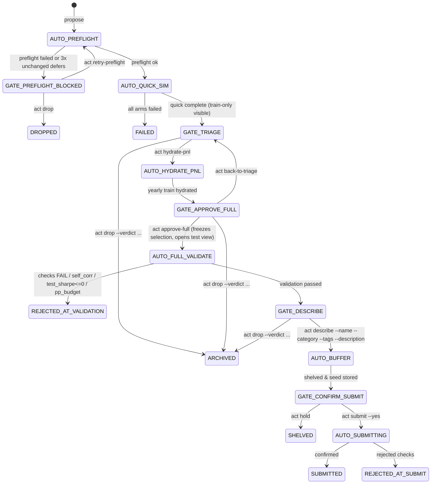

# 状态机实验流程与台账复盘（v4）

v4 版本采用**常驻单写入者 Daemon + 非阻塞 CLI + 持久化四门禁状态机**替代旧版文件队列与阻塞式长命令。所有研究状态持久化在 `<research_dir>/runs/<run_id>.json`，台账证据与失败记录持久化在 `<research_dir>/alpha-registry.jsonl`。

> 在仓库根目录执行命令；若有多个研究目录，请始终传递同一个 `--research-dir PATH`。先运行 `python research_cli.py brief` 核对 `data.research_dir` 与工作区状态。

## 1. 常驻 Daemon 与短命令工作链

```bash
python research_cli.py daemon start
python research_cli.py brief
python research_cli.py propose SPEC.json
python research_cli.py wait --max-wait 30
python research_cli.py inbox
python research_cli.py inspect RUN_ID
```

- `propose SPEC.json` 进行离线 AST / Python `@alpha(data=[...])` / 重复请求指纹校验，并立即创建处于 `AUTO_PREFLIGHT` 的运行文档返回，**不等待模拟或网络请求**；若 daemon 尚未启动且未在测试禁用模式下，CLI 会按需拉起或使用 `daemon start`。
- 后台 worker 按单一写入者锁 `daemon/state.lock` 调度优先级执行：
  1. 主动取消 (`AUTO_CANCELLING`) 与提交核实 (`AUTO_SUBMITTING`)
  2. 入架写描述 (`AUTO_BUFFER`)
  3. 进行中/待启动 FULL 验证 (`AUTO_FULL_VALIDATE`)
  4. 进行中 QUICK (`AUTO_QUICK_SIM`)、PnL 补水 (`AUTO_HYDRATE_PNL`)、预检 (`AUTO_PREFLIGHT`)、未发送新 QUICK (`AUTO_QUICK_SIM`)
- 所有需要智能体做出研究/风控决断的节点均自动暂停在 `GATE_*` 态，通过 `wait` 的条件变量即时唤醒或 `inbox` 查询。
- 调度配额护栏可通过 `python research_cli.py daemon config --quota-floor 20 --concurrency 8` 配置：`quota_floor` 仅暂停未启动的新 QUICK 臂；FULL 验证与已受理任务回读仅在平台 `blocked=true` 时暂停。

## 2. 四门禁状态机全图与转换表



| 状态 | 类型 | 触发条件 / 协议保证 | 下一步 CLI |
| --- | --- | --- | --- |
| `AUTO_PREFLIGHT` | 自动 | 账本查重 + 在线字段/算子预检；连续 3 轮无进展且无 `Retry-After` 触发熔断 | 等待或 `cancel RUN_ID` |
| `GATE_PREFLIGHT_BLOCKED` | 门禁 | 预检报错或退避熔断 | `act RUN_ID retry-preflight` 或 `act RUN_ID drop --reason ...` |
| `AUTO_QUICK_SIM` | 自动 | 执行 QUICK（遵守 `quota_floor`），将已完成/终态失败写入 `alpha-registry.jsonl` | 等待 `wait` / `inbox` |
| `GATE_TRIAGE` | 门禁 | 仅暴露训练期指标；`inspect` 强制隐藏测试期及验证字段 | `act RUN_ID hydrate-pnl --top 3`（或 `--arms a,b`）或 `drop` |
| `AUTO_HYDRATE_PNL` | 自动 | 对选中候选拉取日频 PnL 并评估训练窗口逐年 Sharpe | 等待 `wait` |
| `GATE_APPROVE_FULL` | 门禁 | 训练期与逐年证据齐全，**测试窗口仍然关闭** | `act RUN_ID approve-full`（冻结 `runs/<id>-selection.json`） / `back-to-triage` / `drop` |
| `AUTO_FULL_VALIDATE` | 自动 | 跑 FULL、实时检查、自相关与 5/10/20 bps 成本审计；任意失败自动转 `REJECTED_AT_VALIDATION` | `inspect RUN_ID` 查看含 `train+test` 与 `cost_audit` 完整结果 |
| `GATE_DESCRIBE` | 门禁 | 验证通过；等待填写候选元数据与官方三段式模板说明 | `act RUN_ID describe --name ... --category ... --tags ... --description ...` |
| `AUTO_BUFFER` | 自动 | `set_alpha_metadata` 写入平台并回读校验一致，再写入 `seeds.jsonl` 与 `submit-buffer.jsonl` | `shelf list` / `shelf plan` |
| `GATE_CONFIRM_SUBMIT` | 门禁 | 候选已安全入架；**可选择直接提交或暂存候补** | `act RUN_ID hold`（转 `SHELVED`）或 `act RUN_ID submit --yes`（需 `BRAIN_ALLOW_AGENT_SUBMIT=true`） |
| `AUTO_SUBMITTING` | 自动 | 持久化发送 `POST /alphas/{id}/submit`；遇 `UNCERTAIN` 仅走只读回查，绝不重发 `POST` | 等待终态 `SUBMITTED` 或 `REJECTED_AT_SUBMIT` |

## 3. 协议级训练/测试隔离（Train/Test Firewall）

- `public_run_view`（被 `inspect`、`inbox`、`wait`、`propose`、`act` 共用）在 `PRE_FREEZE_STATES`（`AUTO_PREFLIGHT` 至 `GATE_APPROVE_FULL`）或 `selection_frozen == false` 时，协议层自动剔除行内的 `test`、`test_sharpe`、`test_fitness`、`test_turnover`、`retention`、`checks`、`cost_audit`、`validation` 与 `out_of_sample.test`。
- 只有在 `act RUN_ID approve-full` 不可逆地冻结 `runs/<run_id>-selection.json` 并置 `selection_frozen = true` 后，`inspect RUN_ID` 才打开 `test_view_open: true` 并暴露测试期留存、平台实时 checks 与成本净 Sharpe。

## 4. Power Pool 官方说明模板与 `GATE_DESCRIBE`

提交元数据在 `GATE_DESCRIBE` 阶段即做严格离线校验，不通过则拒绝进入 `AUTO_BUFFER`：
- `name` 非空；`category` 为 `ANALYST`、`FUNDAMENTAL`、`PRICE_VOLUME`、`SENTIMENT` 或 `VOLUME`；`tags` 至少一项。
- `description` 去掉首尾空白后至少 100 字符，且逐字包含三个标题行：
  - `Idea:`
  - `Rationale for data used:`
  - `Rationale for operators used:`
- 每个标题独占一行后接至少一个 `- ` 列表项；旧版 `IDEA:` / `RATIONALE:` 会被拒绝。`AUTO_BUFFER` 会调用 `set_alpha_metadata` 写入平台并回读 `regular.description` 严格一致后才落盘 `seeds.jsonl` 和 `submit-buffer.jsonl`。

## 5. 台账分析、失败留痕与旧版工作区迁移

```bash
python research_cli.py ledger analyze --group-by scope --limit 8
python research_cli.py ledger analyze --region ASI --delay 1 --mode QUICK --group-by mechanism --cost-bps 10 --max-turnover 0.20 --limit 8 --yearly
```

- **失败记录**：终态失败写入 `alpha-registry.jsonl`，带 `failure:` 稳定键与 `execution_outcome=failed`，不会把技术报错自动当成假设被证伪（`falsified`）。
- **检查覆盖态 (`checks_state`)**：区分 `observed`、`missing`、`stale`、`partial`；缺失和 `PENDING` 均保持未知，不能视为通过。
- **训练期参数与逐年口径**：默认 `--min-train-sharpe 1.0`、`--cost-bps 10`；逐年 `pass` 要求至少 3 个完整训练日历年（含 1 月和 12 月观测且 ≥145 个有效日值），最差年 > 0，近三年均值 ≥ 1.0，无连续三年 < 0.3。
- **候选架独立性规划**：入架候选可随时通过 `shelf list` 和 `shelf plan` 基于训练期日频 PnL 计算最大权重独立子集并规划提交顺序。
- **v3 工作区迁移**：旧目录存在 `backlog/` 或 `backlog-results/` 时，先预览再迁移：
  ```bash
  python research_cli.py migrate-workspace --dry-run
  python research_cli.py migrate-workspace
  ```
  旧文件将被导入为 `runs/<run_id>.json` 对应状态（已有训练指标的 QUICK 批直接进入 `GATE_TRIAGE`），原目录整洁归档至 `legacy-v3-archive/`。
